<div align="center">

# DenseNet121 for 14 chest X-ray findings

### What changes when we weight the loss, transfer ImageNet features, or train one model per disease?

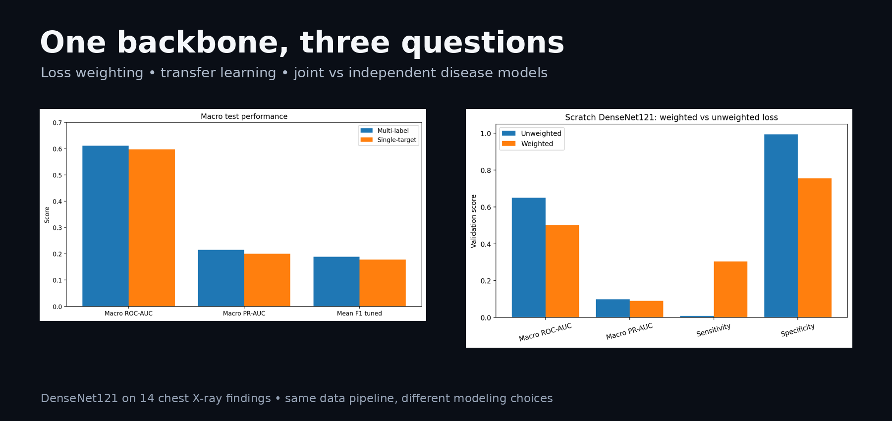

</div>

This repository contains two closely related experiments on the same 14 thoracic findings:

1. a **multi-label DenseNet121**, where one network predicts all 14 diseases together;
2. **14 independent single-target DenseNet121 models**, one classifier per disease.

The interesting part is not simply asking which line in a table is larger. The notebooks also test **weighted vs unweighted BCE loss** and **random initialization vs ImageNet pretraining**, which makes it possible to see how the modeling choices interact with a heavily imbalanced chest X-ray problem.

---

## What was actually tested

| Experiment | Architecture | Initialization | Loss | Training budget |
|---|---|---|---|---|
| Multi-label, scratch | 1 DenseNet121 → 14 outputs | Random | Unweighted BCE | 10 epochs |
| Multi-label, scratch + weighted loss | 1 DenseNet121 → 14 outputs | Random | BCE with `pos_weight` | 10 epochs |
| Multi-label, transfer learning | 1 DenseNet121 → 14 outputs | ImageNet | Unweighted BCE | 10 epochs |
| Single-target | 14 DenseNet121 models → 1 output each | ImageNet | Unweighted BCE | Up to 10 epochs **per pathology**, early stopping |

The preprocessing is intentionally kept stable: `320 × 320` images, sample-wise normalization, Adam with learning rate `1e-4`, and patient-level data handling.

---

## Weighting the loss did what we would expect — but at a cost

The first controlled comparison starts both scratch DenseNet121 models from the **same initialization**, sends them through the same batch order, and changes only the loss.

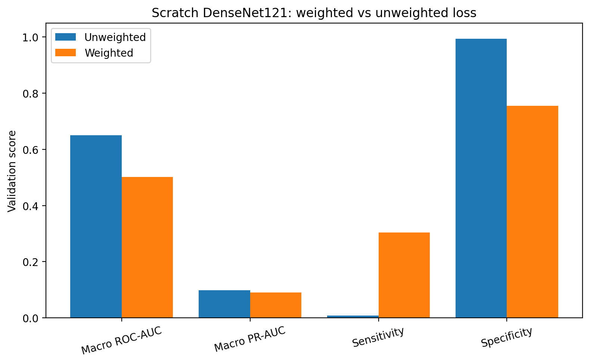

On validation:

| Scratch multi-label model | Macro ROC-AUC | Macro PR-AUC | Mean sensitivity | Mean specificity |
|---|---:|---:|---:|---:|
| Unweighted BCE | **0.651** | **0.098** | 0.008 | **0.994** |
| Weighted BCE | 0.501 | 0.091 | **0.304** | 0.755 |

The weighted loss substantially increases sensitivity, but here that comes with a marked drop in specificity and no improvement in macro ROC-AUC or PR-AUC. That is why the final multi-label experiment keeps **unweighted BCE** rather than assuming that class weighting is automatically better.

---

## ImageNet pretraining helped the ranking metrics

Using the same unweighted loss and the same 10-epoch budget, the notebook then compares a scratch model with an ImageNet-pretrained DenseNet121.

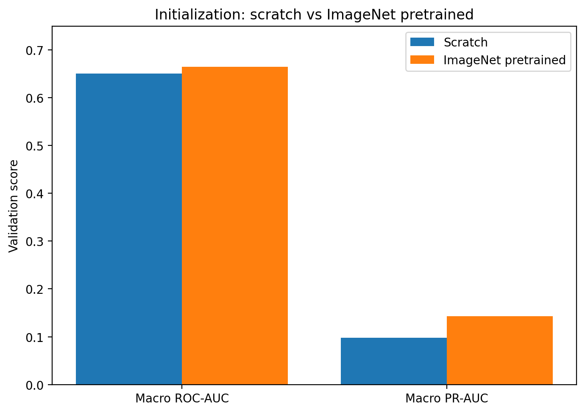

Validation macro scores move from approximately:

- **ROC-AUC:** `0.651 → 0.665`
- **PR-AUC:** `0.098 → 0.143`

This experiment is the reason the later single-target models also use an ImageNet-pretrained backbone.

---

## Multi-label or one model per pathology?

The final comparison is the most intuitive one: should one DenseNet121 learn the 14 findings jointly, or should each disease receive its own classifier?

### Overall test performance

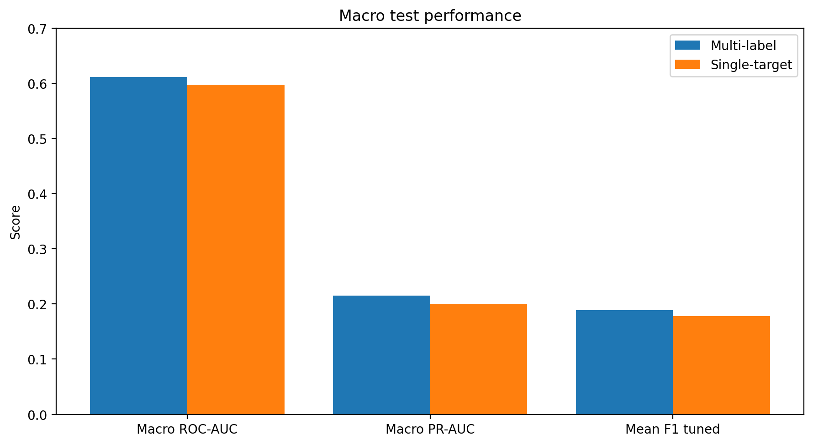

| Model | Macro ROC-AUC | Macro PR-AUC | Mean F1 (tuned) | Mean sensitivity (tuned) | Mean specificity (tuned) |
|---|---:|---:|---:|---:|---:|
| Multi-label pretrained DenseNet121 | **0.611** | **0.215** | **0.189** | 0.239 | **0.850** |
| 14 pretrained single-target models | 0.597 | 0.200 | 0.178 | **0.267** | 0.805 |

At the macro level, the multi-label model is slightly stronger on ROC-AUC, PR-AUC, F1 and specificity, while the independent models recover somewhat more sensitivity.

The differences are not uniform across diseases, which is why the per-pathology view matters more than a single average.

### ROC-AUC by pathology

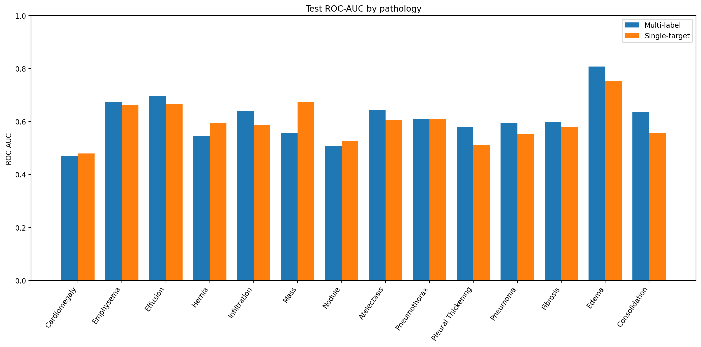

### PR-AUC by pathology

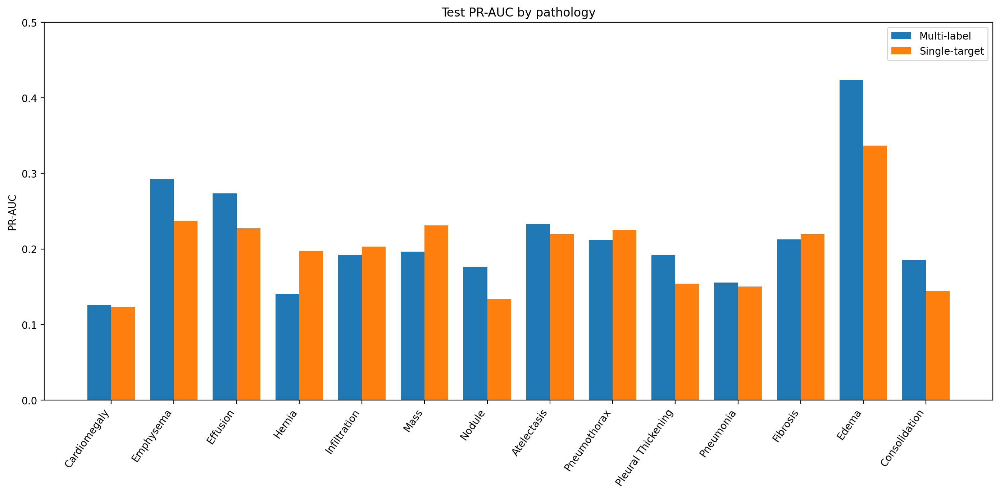

Some pathologies benefit from the independent setup, while others are stronger in the joint model. This is exactly the pattern we would expect if shared representation learning helps certain findings but not every target equally.

---

## The comparison is useful — but not fully compute-matched

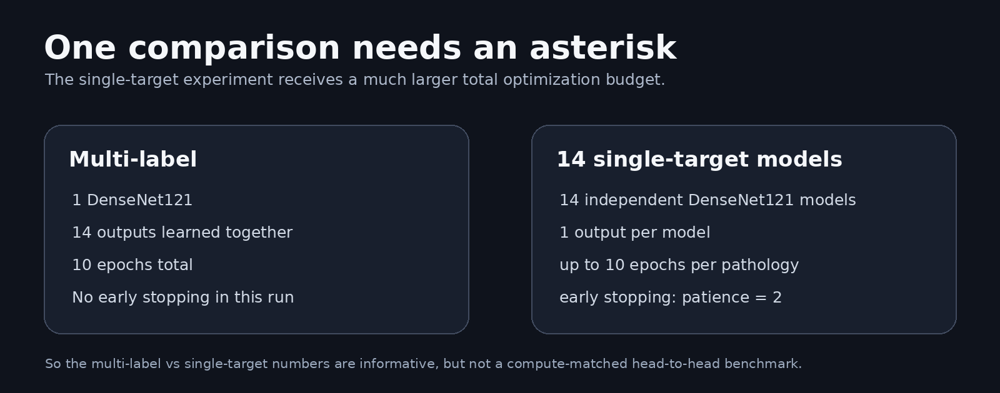

This point matters enough to state explicitly.

The multi-label model is trained **once for 10 epochs** and learns all 14 outputs simultaneously.

The single-target experiment trains **14 separate models**, each with a maximum of **10 epochs**, and uses **early stopping with patience 2**. Several diseases stop well before epoch 10, but each pathology still receives its own optimization process and its own model capacity.

So this is **not a perfectly fair compute-budget comparison**.

A more rigorous head-to-head experiment would either:

- match the total optimization budget;
- match the number of gradient updates;
- or report performance against training compute / wall-clock cost.

The current comparison is still scientifically useful for asking whether independent disease-specific optimization changes predictive behavior, but it should not be interpreted as a compute-controlled architecture benchmark.

---

## Thresholds matter almost as much as the architecture

Both final setups tune a separate classification threshold for each pathology using validation data.

For the multi-label pretrained model, moving from the default threshold of `0.5` to validation-selected thresholds changes the test summary from:

| Threshold strategy | Macro ROC-AUC | Macro PR-AUC | Mean F1 | Mean sensitivity | Mean specificity |
|---|---:|---:|---:|---:|---:|
| `0.5` for every disease | 0.611 | 0.215 | 0.025 | 0.016 | 0.991 |
| Validation-tuned per disease | 0.611 | 0.215 | **0.189** | **0.239** | 0.850 |

ROC-AUC and PR-AUC do not change because they are threshold-independent. F1, sensitivity and specificity do.

That distinction is important in an imbalanced medical setting: a model can rank cases reasonably well while performing poorly at an arbitrary threshold.

---

## The actual test curves

<table>
<tr>
<td width="50%" valign="top">

### Multi-label ROC

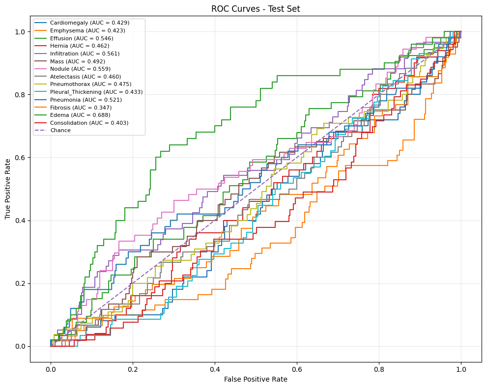

</td>
<td width="50%" valign="top">

### Single-target ROC

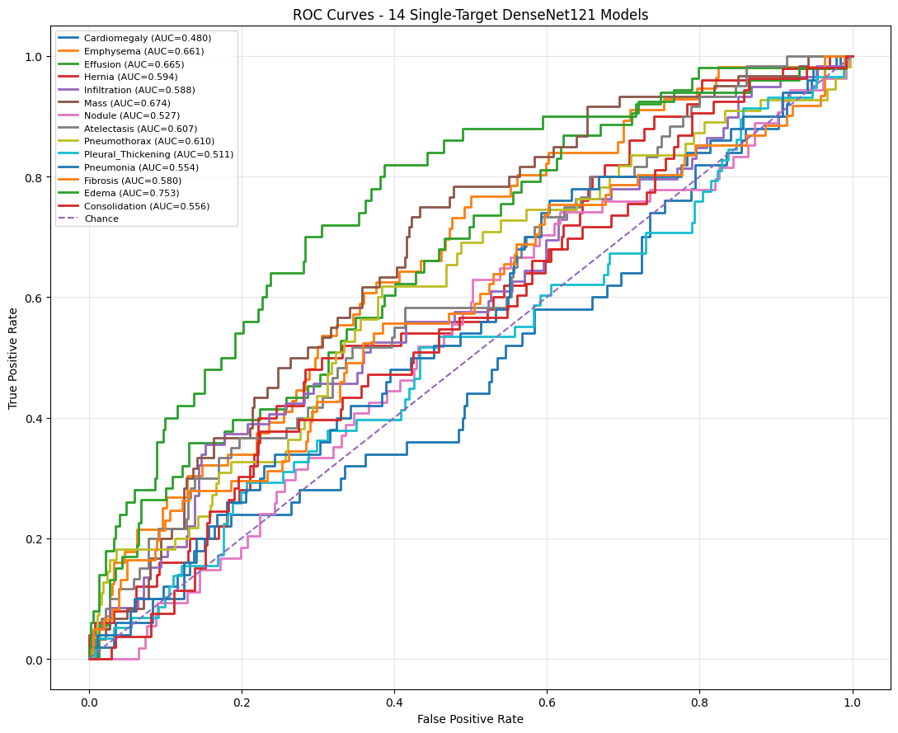

</td>
</tr>
<tr>
<td width="50%" valign="top">

### Multi-label Precision–Recall

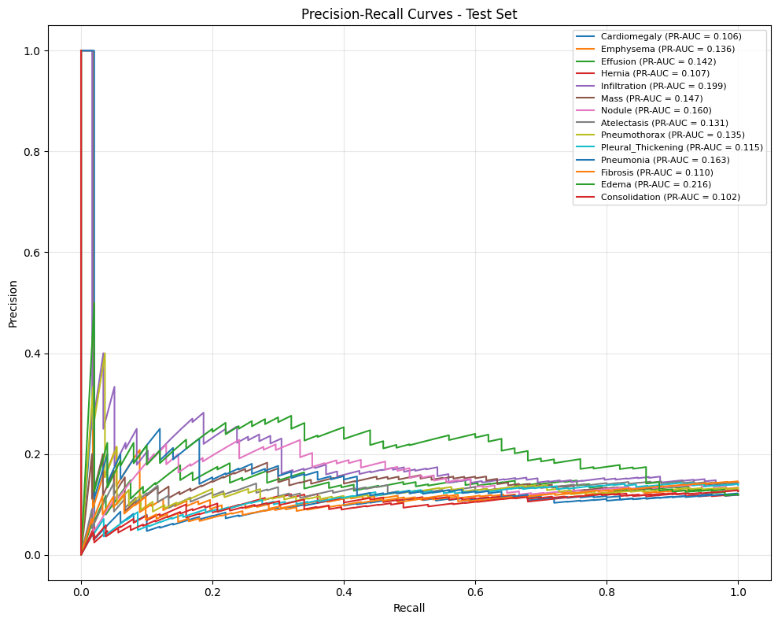

</td>
<td width="50%" valign="top">

### Single-target Precision–Recall

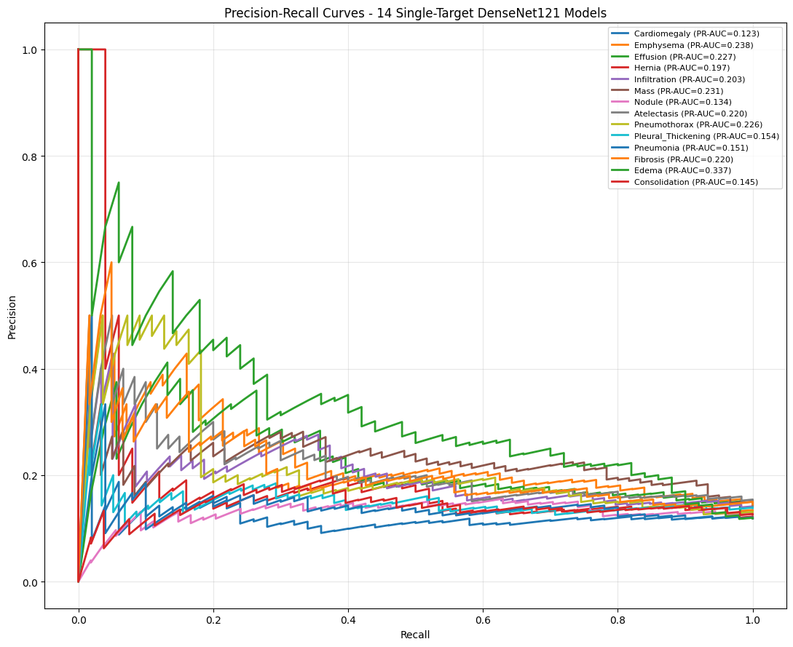

</td>
</tr>
</table>

---

## What I would take away from these experiments

The strongest result is not that one architecture “wins.”

The more interesting picture is:

- **class weighting** recovered sensitivity but produced too many false positives in this experiment;
- **ImageNet pretraining** improved the ranking metrics over scratch training;
- the **joint multi-label model** was slightly stronger overall on ROC-AUC and PR-AUC;
- **single-target optimization** increased mean sensitivity, but with lower specificity and a much larger total training budget;
- **per-disease thresholds** were essential because `0.5` was a poor operating point for many rare findings.

That makes the two notebooks complementary rather than redundant.

---

## Files

```text
.
├── chest_xray_classification_mutilabels_un_weighted.ipynb
├── chest_xray_single_target_models_unweighted.ipynb
└── assets/
    ├── comparison_hero.png
    ├── weighted_vs_unweighted_validation.png
    ├── scratch_vs_pretrained_validation.png
    ├── macro_test_comparison.png
    ├── roc_auc_per_pathology_comparison.png
    ├── pr_auc_per_pathology_comparison.png
    ├── training_budget_caveat.png
    ├── multilabel_roc_curves.png
    ├── multilabel_pr_curves.png
    ├── single_target_roc_curves.png
    └── single_target_pr_curves.png
```

---

<div align="center">

### The central question is not only *which model scores higher?*

**It is which modeling choice buys that score — loss weighting, transfer learning, shared representation, or simply more optimization.**

</div>


---
noteId: "e47def10c3c811f186fbe7e00c483bd3"
tags: []

---

<div align="center">

# Looking inside two chest X-ray classifiers

### Grad-CAM · SHAP · LIME on the same Effusion and Pneumothorax decisions

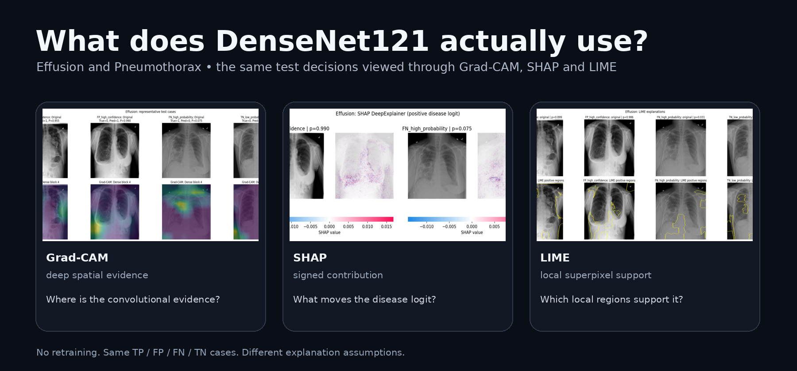

</div>

This notebook started from a simple question: **when a saved DenseNet121 model predicts Effusion or Pneumothorax, what image evidence is actually driving that decision?**

The goal is not to produce three attractive heatmaps and call the model “interpretable.” The two classifiers are loaded from their saved checkpoints, the test split is left untouched, and the **same automatically selected TP, FP, FN and TN cases** are passed through Grad-CAM, SHAP and LIME. That makes disagreement between methods as interesting as agreement.

> **No model is retrained in this notebook.** The analysis begins from the already trained single-target checkpoints.

---

## The experiment in one glance

| | What it asks | What is shown |
|---|---|---|
| **Grad-CAM** | Where do deep convolutional features support the positive disease logit? | Heatmaps from all four DenseNet blocks, plus a compact final-block comparison |
| **SHAP DeepExplainer** | Which pixels push the logit away from a training-image reference? | Signed image attributions for the same representative cases |
| **LIME** | Which local superpixels make the prediction more likely around this image? | Positive local regions from a perturbation-based surrogate |

The comparison is deliberately case-matched. For each disease, the notebook automatically takes:

- the **highest-probability true positive**;
- the **highest-probability false positive**;
- the **highest-probability false negative**;
- the **lowest-probability true negative**.

This avoids hand-picking the visually nicest explanation for each method.

---

## Grad-CAM — follow the spatial evidence through DenseNet

Grad-CAM is computed at four depths of DenseNet121. Early blocks are visually busy; the final block is much more spatially concentrated. Looking at the progression matters because a final heatmap alone can hide how diffuse the earlier representation was.

### Effusion

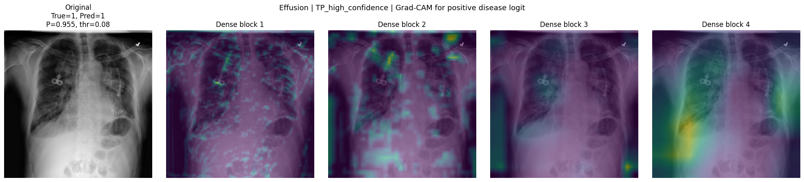

The compact comparison below keeps the same four representative decisions and shows only the deepest block.

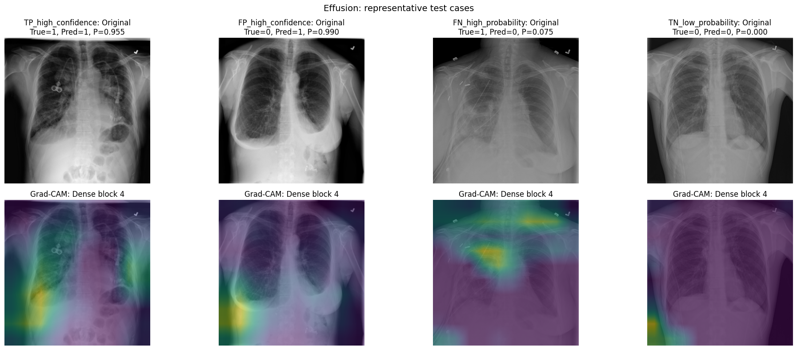

### Pneumothorax

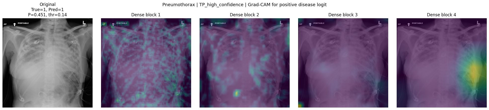

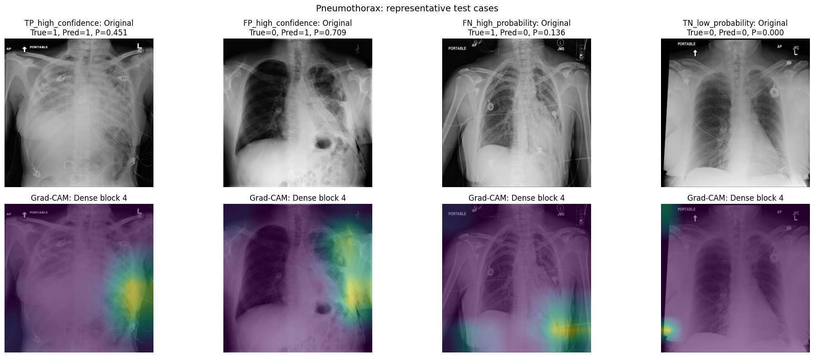

A highlighted region should be read as **model evidence**, not as a lesion annotation. Grad-CAM does not establish that a highlighted area is clinically correct.

---

## SHAP — positive and negative contributions to the logit

SHAP answers a different question. `DeepExplainer` compares each explained image with a small background sampled from the training data and estimates how image content moves the disease logit relative to that reference.

Because the same TP/FP/FN/TN cases are reused, the SHAP panels can be compared directly with Grad-CAM instead of becoming a separate gallery.

<table>
<tr>
<td width="50%" valign="top">
<strong>Effusion</strong><br><br>
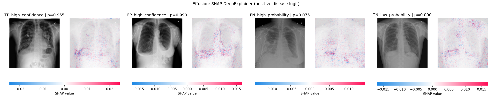
</td>
<td width="50%" valign="top">
<strong>Pneumothorax</strong><br><br>
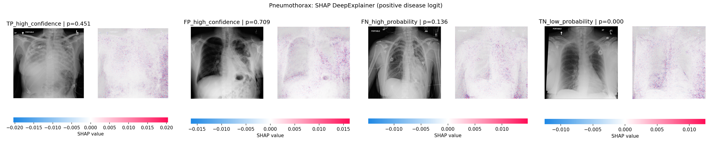
</td>
</tr>
</table>

The notebook also stores the raw SHAP arrays and runs an additivity check, so the visualizations are not the only artifact retained from the explanation step.

---

## LIME — perturb the image and ask what survives locally

LIME works without following gradients through the network. Each radiograph is segmented with SLIC, superpixels are switched on and off across many perturbations, and a local surrogate is fitted around the original prediction.

Here the explanation is intentionally restricted to **positive support for the disease class**.

<table>
<tr>
<td width="50%" valign="top">
<strong>Effusion</strong><br><br>
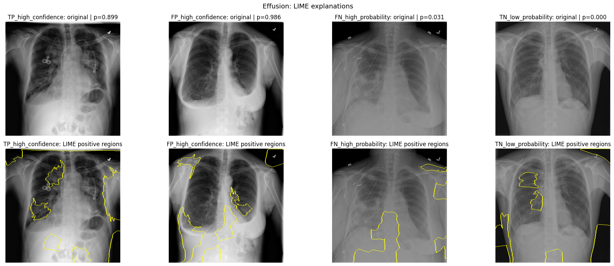
</td>
<td width="50%" valign="top">
<strong>Pneumothorax</strong><br><br>
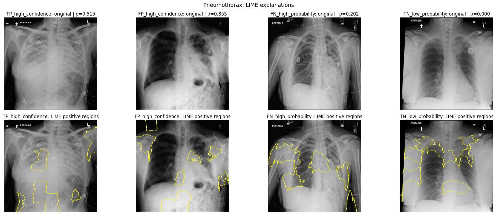
</td>
</tr>
</table>

The default configuration uses **1,000 perturbations per case**, 80 SLIC segments and a fixed random seed so that comparisons are not driven by a different segmentation every time the notebook runs.

---

## Before explaining anything: does the reloaded model still behave as expected?

The notebook first performs a small test-set sanity check after reloading both checkpoints.

| Disease | Validation threshold | ROC-AUC | PR-AUC | F1 | Sensitivity | Specificity |
|---|---:|---:|---:|---:|---:|---:|
| Effusion | 0.08 | 0.665 | 0.227 | 0.271 | 0.566 | 0.624 |
| Pneumothorax | 0.14 | 0.610 | 0.226 | 0.152 | 0.091 | 0.984 |

These numbers are reported because explanation quality should not be discussed as if it were independent of predictive behavior. The notebook is an **interpretability analysis**, not a claim of clinical-grade diagnostic performance.

---

## Why I compare the three methods instead of choosing one

The methods do not share the same notion of “importance”:

- **Grad-CAM** is tied to convolutional feature maps and gives a coarse spatial view.
- **SHAP** is reference-dependent and gives signed attribution estimates.
- **LIME** is local and perturbation-based; it explains the behavior of a surrogate near one image.

If two or three methods repeatedly emphasize similar regions on the same case, that is useful evidence of consistency. If they disagree, that is also a result worth inspecting rather than something to hide.

In particular, false positives and false negatives are kept in the analysis because they are often more revealing than successful predictions.

---

## Reproducibility choices that matter

The notebook is intentionally conservative about changing the original experiment:

- seed fixed to `42`;
- patient-disjoint train / validation / test handling;
- images resized to `320 × 320`;
- the same sample-wise normalization used by the saved classifiers;
- one DenseNet121 output logit per disease;
- saved validation thresholds reused at inference;
- Grad-CAM, SHAP and LIME applied to the **same representative test cases**;
- generated arrays and figures written to disk.

The checkpoint loader uses `weights_only=False` because the saved checkpoint contains more than a raw `state_dict`. Only load checkpoint files you trust.

---

## Expected project layout

```text
.
├── XAI_GradCAM_SHAP_LIME_Effusion_Pneumothorax_DenseNet121_REVISED.ipynb
│
├── data/
│   └── nih/
│       ├── images-small/
│       ├── train-small.csv
│       ├── valid-small.csv
│       └── test.csv
│
├── single_target_checkpoints/
│   ├── densenet121_Effusion.pth
│   └── densenet121_Pneumothorax.pth
│
├── gradcam_outputs/
├── shap_outputs/
│   └── arrays/
├── lime_outputs/
└── assets/
```

---

## Run the notebook

The analysis expects the data and the two saved checkpoints above to already exist.

A minimal Python environment needs:

```bash
pip install torch torchvision numpy pandas scikit-learn matplotlib pillow shap lime scikit-image
```

Then open the notebook and run from top to bottom. CUDA is used automatically when available, but the code also supports CPU execution. SHAP is the most computationally demanding part.

---

## Reading these figures responsibly

This repository is about **model behavior**, not clinical localization.

A heatmap or highlighted superpixel does not prove that the network found a lesion, and agreement between explanation methods does not turn a prediction into a diagnosis. The useful question is narrower:

> **Does the model appear to rely on stable, plausible image regions across correct and incorrect decisions — and do different explanation assumptions tell a compatible story?**

That is why the notebook keeps the failures in view.

---

<div align="center">

**DenseNet121 predictions are easy to score.  
Understanding what they use is the harder part.**

</div>
