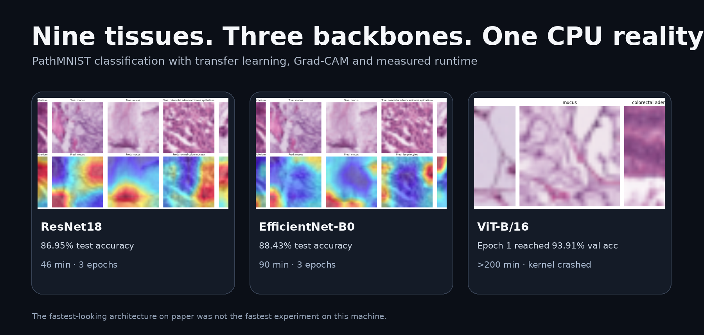
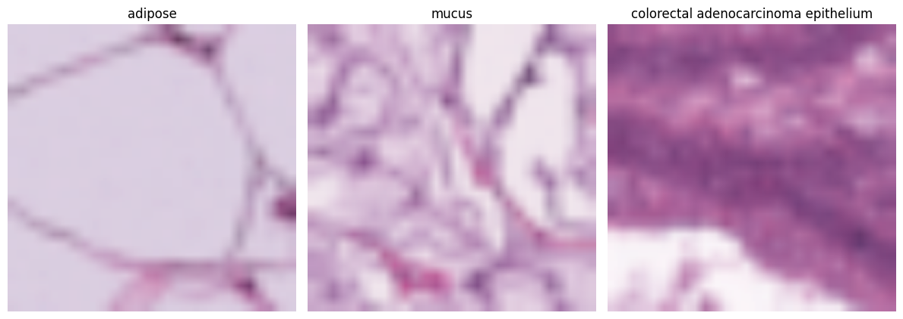
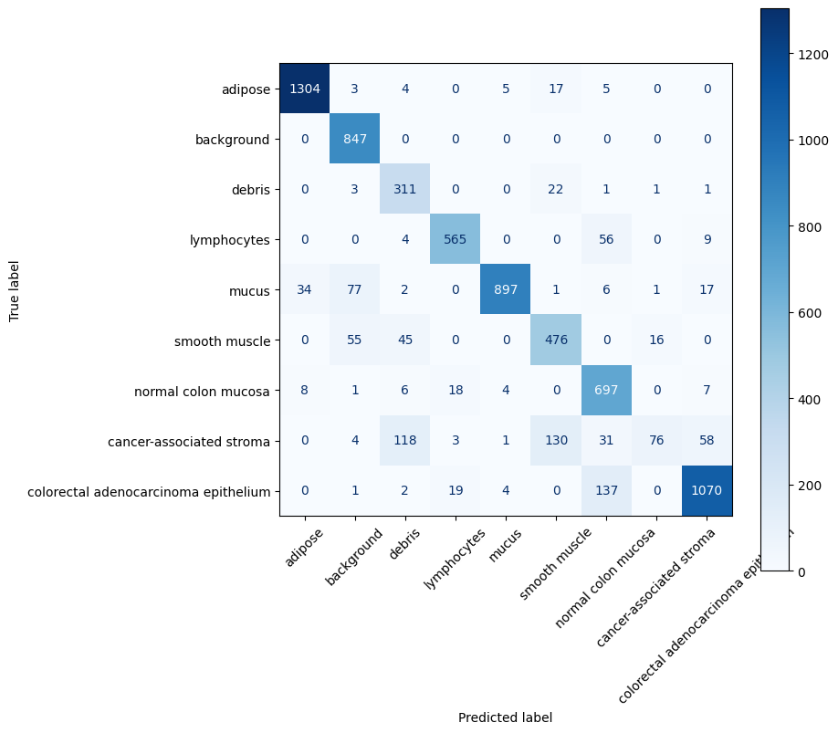
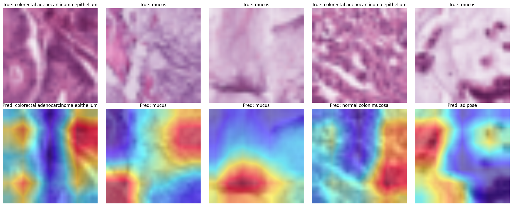
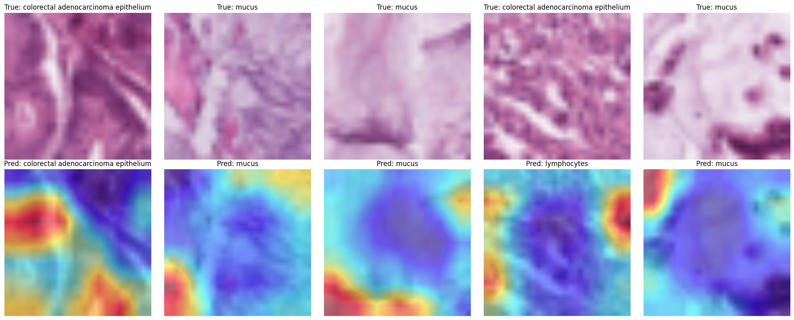

<div align="center">

# PathMNIST — how much model do nine tissue classes really need?

### ResNet18 · EfficientNet-B0 · ViT-B/16 · Grad-CAM · runtime included



</div>

This notebook is a small histopathology experiment with a practical constraint that is easy to hide in benchmark tables: **the model has to finish training on the machine you actually have**.

PathMNIST provides nine tissue categories from colorectal histology patches. The original images are only `28 × 28`, but the notebook resizes them to `224 × 224` so that ImageNet-pretrained backbones can be fine-tuned without redesigning their input pipeline.

The experiment then asks three related questions:

**How well does a compact ResNet18 work? Does EfficientNet-B0 buy enough accuracy to justify extra time? And what happens when a much heavier ViT-B/16 meets the same CPU-bound workflow?**

---

## First, the tissue itself



The notebook uses:

- **9,000 training images**
- **1,001 validation images**
- **7,180 test images**

Only 10% of the original PathMNIST training and validation splits are used for training/validation in this notebook, while the full test split is evaluated.

All three channels are normalized with ImageNet statistics after resizing to `224 × 224`.

---

## ResNet18 — the compact baseline that actually finishes

The first model starts from ImageNet-pretrained ResNet18 weights. Its final fully connected layer is replaced with a nine-class head and the entire network is fine-tuned with Adam for three epochs.

Training on the recorded machine ran on **CPU**.

| Epoch | Train loss | Validation accuracy |
|---:|---:|---:|
| 1 / 3 | 0.4722 | 0.8501 |
| 2 / 3 | 0.2358 | 0.7263 |
| 3 / 3 | 0.1727 | **0.9061** |

### Test set

- **Accuracy:** `0.8695`
- **Macro F1:** `0.8073`
- **Recorded training time:** **46 min**



The confusion matrix makes the class-level errors visible; accuracy alone would hide them.

### What did ResNet18 look at?



Grad-CAM is taken from the last ResNet block. The point here is not to claim that a highlighted region is a pathological annotation. It is simply a way to inspect **where the network's final convolutional representation contributes to its selected class**.

---

## EfficientNet-B0 — slower, but stronger on this run

EfficientNet-B0 uses the same ImageNet-transfer-learning idea and the same three-epoch budget.

| Epoch | Train loss | Validation accuracy |
|---:|---:|---:|
| 1 / 3 | 0.4003 | 0.9271 |
| 2 / 3 | 0.1445 | **0.9640** |
| 3 / 3 | 0.0899 | 0.9500 |

### Test set

- **Accuracy:** `0.8843`
- **Macro F1:** `0.8416`
- **Recorded training time:** **90 min**

That is an absolute gain of roughly **1.5 percentage points in accuracy** and **3.4 points in macro F1** over ResNet18, for almost twice the recorded training time.




For this notebook, EfficientNet-B0 gives the strongest completed test result.

---

## Then ViT-B/16 changed the question

The Vision Transformer also starts from ImageNet weights, with its classification head replaced for the nine PathMNIST categories.

Its first epoch reached:

- **Train loss:** `0.4819`
- **Validation accuracy:** `0.9391`

But the important result is operational:

> **Recorded runtime: more than 200 minutes, after which the kernel crashed.**

So there is no completed three-epoch ViT experiment and no corresponding test-set comparison in this notebook.

That absence should not be hidden. The ViT result is **incomplete**, not worse.

---

## Runtime is part of the result

| Backbone | Completed epochs | Test accuracy | Macro F1 | Recorded time |
|---|---:|---:|---:|---:|
| ResNet18 | 3 / 3 | 0.8695 | 0.8073 | **46 min** |
| EfficientNet-B0 | 3 / 3 | **0.8843** | **0.8416** | **90 min** |
| ViT-B/16 | 1 / 3 completed | — | — | **>200 min, kernel crashed** |

There are also two one-off download costs visible in the notebook:

- PathMNIST dataset download: **12 min 38 s**
- EfficientNet-B0 pretrained weights: **44 s**
- ViT-B/16 pretrained weights: **10 min 29 s**

These download times are not training time, so they are kept separate.

---

## What this notebook says — and what it does not

The experiment supports a modest conclusion:

**EfficientNet-B0 performed better than ResNet18 on this particular reduced-data PathMNIST run, but required substantially more time. ViT-B/16 could not be completed under the same working conditions.**

It does **not** establish a general architecture ranking. The training subset is deliberately small, the budget is only three epochs, and the run was CPU-bound.

That is exactly why the notebook is useful: it shows the difference between a benchmark architecture and a workable experiment.

---

## Notebook flow

```text
PathMNIST
    │
    ├── 28×28 histology patches
    │
    ├── resize to 224×224
    │
    ├── ImageNet normalization
    │
    ├── ResNet18 ──────────> test metrics + Grad-CAM
    │
    ├── EfficientNet-B0 ───> test metrics + Grad-CAM
    │
    └── ViT-B/16 ──────────> interrupted after >200 min
```

---

## Files

```text
.
├── pathmnist.ipynb
└── assets/
    ├── pathmnist_hero.png
    ├── pathmnist_samples.png
    ├── resnet18_evaluation.png
    ├── resnet18_gradcam.png
    ├── efficientnet_b0_evaluation.png
    └── efficientnet_b0_gradcam.png
```

---

<div align="center">

### Accuracy matters. So does the clock.

The best model is not always the one with the largest backbone.

</div>
