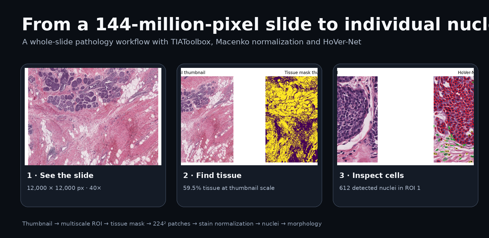
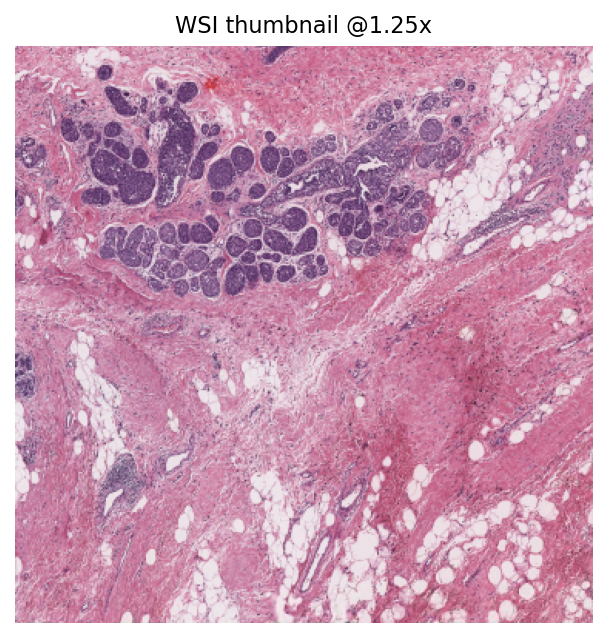
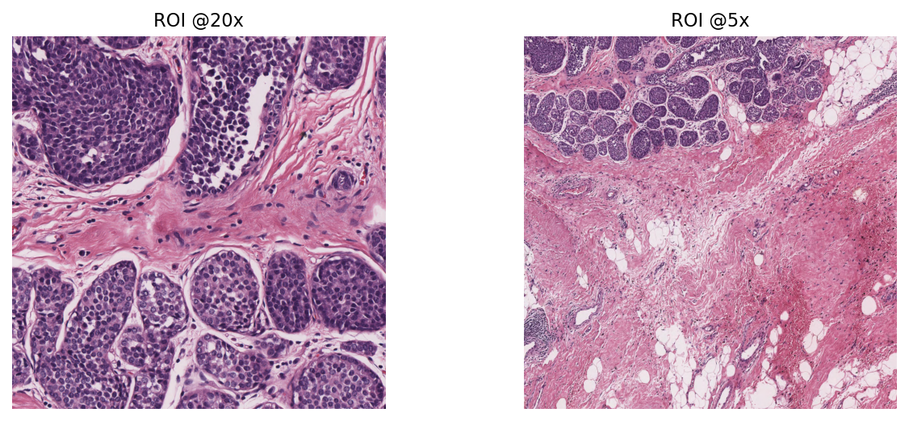
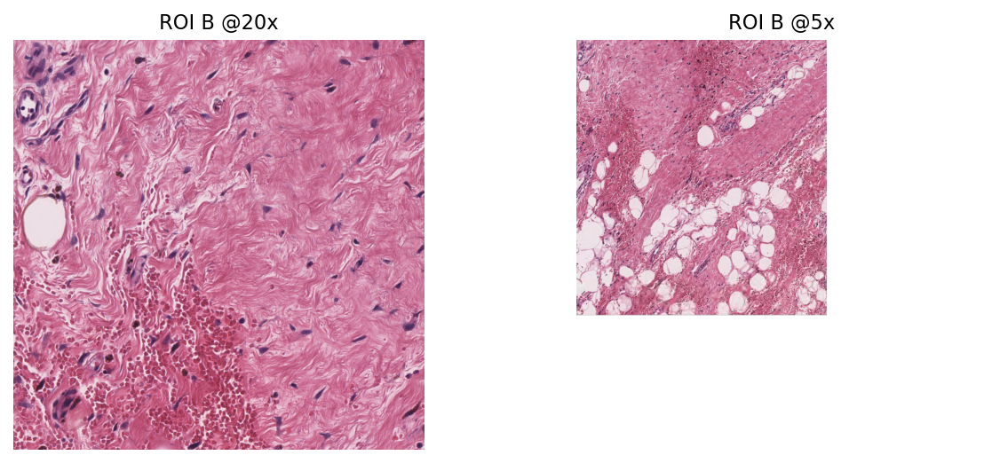
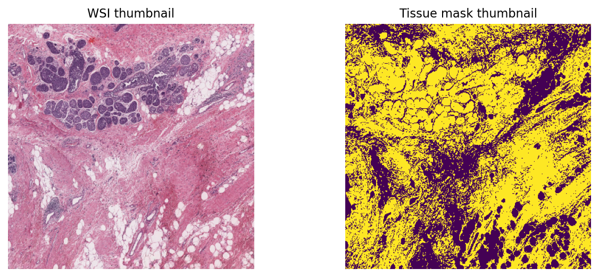
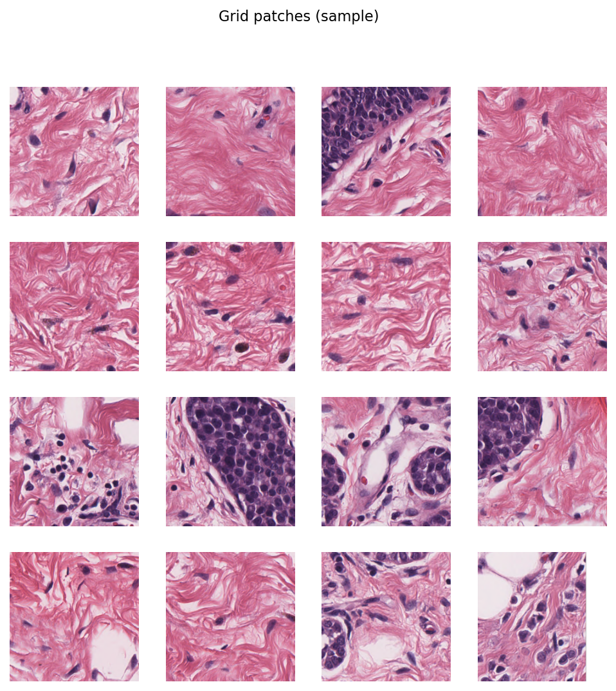
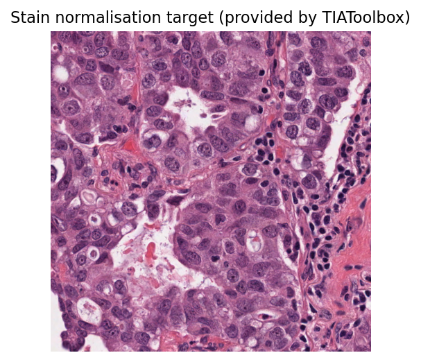
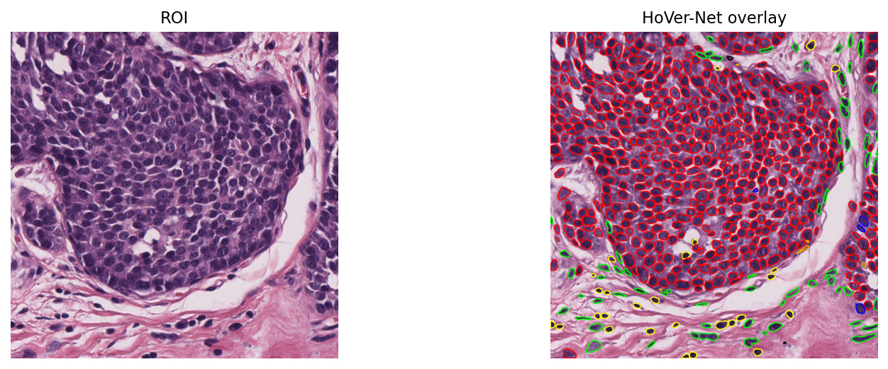
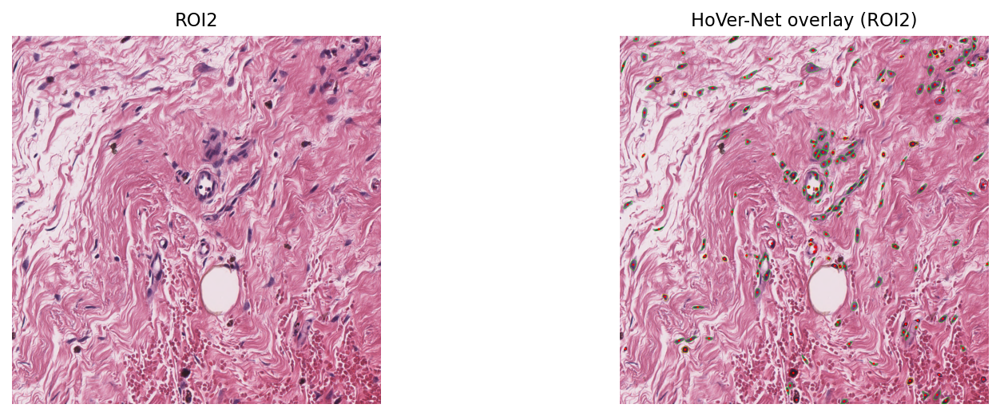
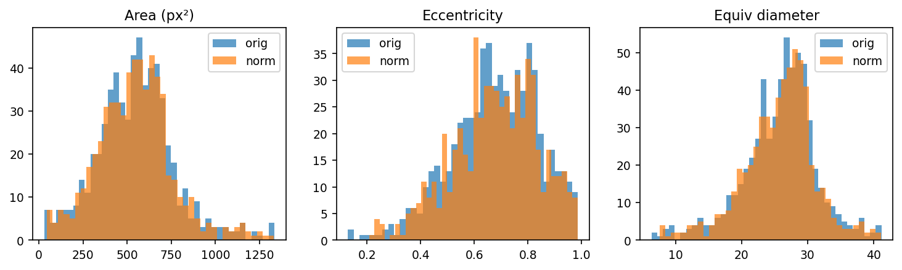

<div align="center">

# From a whole-slide image to measurable nuclei

### TIAToolbox · multiscale WSI reading · tissue masking · Macenko · HoVer-Net



</div>

A whole-slide image is difficult for a simple reason: **there is too much image to look at all at once**.

This notebook starts from an Aperio `.svs` pathology slide and progressively changes scale. It first asks where the tissue is, then samples useful patches, brings H&E staining closer to a common reference, and finally runs HoVer-Net so that individual nuclei become measurable objects rather than pixels.

The result is not just a sequence of visualizations. It is a complete path from **slide-level context to cell-level morphology**.

---

## The slide is already large before any model runs

The sample WSI is:

- **12,000 × 12,000 pixels**
- approximately **144 million pixels**
- **18.8 MB** on disk
- scanned at **40×**
- baseline resolution: about **0.2505 µm/pixel**
- two pyramid levels: `12,000²` and `3,000²`
- approximate physical extent: **3.01 mm × 3.01 mm**



A `375 × 375` thumbnail is therefore the sensible first view. Loading the entire baseline image just to orient ourselves would be unnecessary.

---

## One slide, several scales

The same starting location is read at **20×** and **5×**.



The output image dimensions are the same, but the physical field of view is not:

- **20×** keeps more cellular detail;
- **5×** includes more surrounding tissue architecture.

That distinction is central to computational pathology. A nucleus and its tissue context do not live at the same useful scale.

Two additional locations are inspected for the same reason:

<table>
<tr>
<td width="50%">

</td>
<td width="50%">

</td>
</tr>
</table>

---

## Before extracting patches, remove the empty slide

A tissue mask is computed at thumbnail scale.



The measured tissue fraction is:

### **59.5%**

That mask is then used to guide patch extraction so that compute is spent mostly on tissue rather than glass/background.

---

## Turning the slide into model-sized pieces

Patches are extracted at:

- **224 × 224 pixels**
- **0.5 µm/pixel**
- coarse stride: **448 × 448**

A grid of 16 extracted examples is shown below.



At this point the workflow has moved from a 144-million-pixel slide to manageable local fields that can be passed through downstream models.

---

## H&E colour is biological context — and technical variation

Histology pipelines can be sensitive to staining differences. The notebook fits a **Macenko stain normalizer** using a reference image supplied through TIAToolbox.



The normalizer is then applied to extracted tissue patches, and RGB means/standard deviations are compared before and after normalization.

This is not cosmetic recolouring. It is an attempt to make stain appearance more comparable before downstream image analysis.

---

## HoVer-Net turns pixels into nuclei

The notebook runs `hovernet_fast-pannuke` through TIAToolbox's `MultiTaskSegmentor`.

For the first `1024 × 1024` region:

### **612 nuclei detected**



The model output stores:

- bounding boxes;
- centroids;
- contours;
- class probabilities;
- nucleus type.

The notebook maps the predicted types to:

`Background · Neoplastic · Inflammatory · Connective · Dead · Non-Neoplastic Epithelial`

A second WSI location is deliberately processed rather than assuming the first region represents the whole slide.

### ROI 2: **178 detected nuclei**

Its type counts in the notebook are:

| Type ID | Count |
|---:|---:|
| 1 | 7 |
| 2 | 25 |
| 3 | 136 |
| 4 | 10 |



---

## Segmentation is only useful if we can measure what was segmented

Each predicted contour is rasterized and passed to `regionprops`. For every nucleus the notebook extracts:

- area in pixels²;
- eccentricity;
- equivalent diameter;
- centroid coordinates;
- predicted type.

All **612 / 612** nuclei from the first ROI produced morphology features.



The first few detected nuclei already show why instance-level analysis is richer than a simple tissue label: cells differ in size, shape and elongation even within one field.

---

## What happens after stain normalization?

HoVer-Net is also rerun on the normalized version of the first ROI.

- original ROI: **612** nuclei with extracted features;
- normalized ROI: **599** nuclei with extracted features.

The morphology distributions are then compared before and after normalization.

This is a useful sanity check: stain normalization is not just a preprocessing step in isolation; it can change what a downstream segmentation model detects.

---

## About runtime

The notebook does **not record reliable wall-clock durations** for the TIAToolbox steps.

That includes:

- WSI reading;
- tissue masking;
- patch extraction;
- Macenko normalization;
- the three HoVer-Net inference runs.

The progress bars visible in the saved outputs were not preserved with trustworthy completed timing values, so this README deliberately does **not invent runtimes**.

What the notebook does make explicit is that the HoVer-Net ROI was kept relatively small to reduce processing time, particularly when using CPU execution, and that model inference proceeds over **13 patches** for the selected `1024 × 1024` regions.

A future benchmark version should wrap the main stages with `time.perf_counter()` and report CPU/GPU hardware alongside the elapsed times.

---

## The whole workflow

```text
Aperio WSI (.svs)
      │
      ▼
slide metadata + thumbnail
      │
      ▼
multiscale ROIs (20× / 5×)
      │
      ▼
tissue mask
      │
      ▼
224×224 tissue patches
      │
      ▼
Macenko stain normalization
      │
      ▼
HoVer-Net instance segmentation
      │
      ▼
nuclear type + contour + centroid
      │
      ▼
area · eccentricity · equivalent diameter
```

---

## Why this notebook is interesting

The strongest part of the workflow is the change in representation.

The same specimen is successively treated as:

1. a **whole slide**;
2. a **multiscale tissue region**;
3. a collection of **patches**;
4. normalized **H&E appearance**;
5. individual **nuclear instances**;
6. a table of **quantitative morphology**.

That transition — from gigapixel-style pathology imagery to structured cell-level measurements — is the core idea.

---

## Files

```text
.
├── tiatoolbox.ipynb
└── assets/
    ├── tiatoolbox_hero.png
    ├── wsi_thumbnail.png
    ├── roi_20x_vs_5x.png
    ├── roi_a_multiscale.png
    ├── roi_b_multiscale.png
    ├── tissue_mask.png
    ├── patch_grid.png
    ├── macenko_reference.png
    ├── hovernet_roi1.png
    ├── hovernet_roi2.png
    └── nuclear_morphology_histograms.png
```

---

<div align="center">

### A WSI is not one image problem.

It is a scale problem, a sampling problem, a stain problem, and finally a cell problem.

</div>
