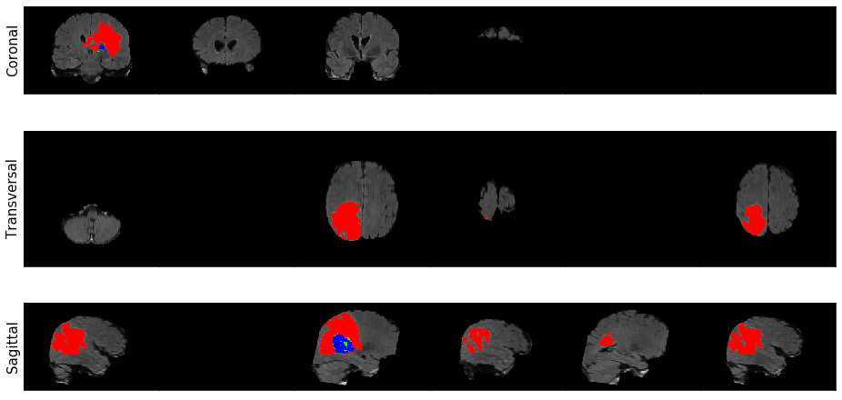
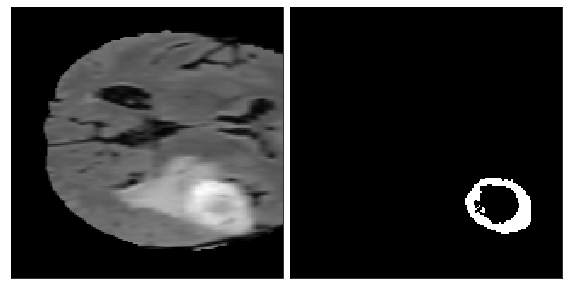
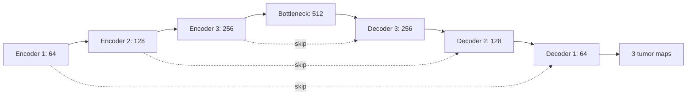

<div align="center">

# Brain Tumor Segmentation
### 3D U-Net | Keras | TensorFlow

**From MRI volumes to tumor segmentation**


</div>

This project comes from my Coursera exam for the **AI for Medicine** course. The notebook is adapted from that exam, with a shorter narrative and the exercise tests removed. The course material remains the source of the workflow and retained reference outputs.

Open [the notebook](brain_tumor_segmentation_3d_unet_keras_tensorflow.ipynb) for the code, visualizations, and evaluation steps.



*Coronal, transverse, and sagittal views extracted from the notebook. Red: edema | Green: non-enhancing tumor | Blue: enhancing tumor.*

---

| Input | Method | Output |
| --- | --- | --- |
| Four MRI sequences | 3D U-Net with Keras & TensorFlow | Three tumor-region channels |
| Volumetric patches | Soft Dice loss | Voxel-level segmentation |

## A look at the predictions

| Ground truth | Model prediction |
| :---: | :---: |
|  |  |

*The same patch, shown with its label and thresholded prediction. These images are retained notebook outputs from the Coursera exam material.*

[Explore the notebook](brain_tumor_segmentation_3d_unet_keras_tensorflow.ipynb) | [Data and preprocessing](#data-and-preprocessing) | [Model and metrics](#model-and-metrics)


## Data and preprocessing

The course uses brain MRI data from the Medical Segmentation Decathlon. Each case contains a NIfTI image with shape `(240, 240, 155, 4)` and a label volume with shape `(240, 240, 155)`. NiBabel reads these files as NumPy arrays.

| Channel | MRI sequence |
| --- | --- |
| 0 | FLAIR |
| 1 | T1-weighted |
| 2 | T1-weighted with gadolinium contrast |
| 3 | T2-weighted |

| Label | Region |
| --- | --- |
| 0 | Background |
| 1 | Edema |
| 2 | Non-enhancing tumor |
| 3 | Enhancing tumor |

Full volumes require substantial memory, so the workflow samples patches of shape `(160, 160, 16)`. Patches with more than 95% background are rejected to retain some tumor content. Image channels are moved to the first axis, and the labels are one-hot encoded with the background channel removed.

Each channel and Z plane is standardized separately. A zero standard deviation must be handled before division. Grayscale displays can look similar before and after normalization because the plotting function rescales intensities.

The visualization utilities use red for edema, green for non-enhancing tumor, and blue for enhancing tumor.

## Pipeline and tensor shapes

<details>
<summary><strong>Complete workflow with array dimensions</strong></summary>

`B` denotes batch size. Files use channels-last format; the model uses channels-first tensors.

| Step | Operation | Shape or result |
| --- | --- | --- |
| 1 | Load NIfTI image and mask | Image `(240,240,155,4)`; mask `(240,240,155)` |
| 2 | Visualize MRI and labels | Shapes unchanged |
| 3 | Sample a spatial patch | Image `(160,160,16,4)`; mask `(160,160,16)` |
| 4 | Reject excessive background | At least 5% tumor content |
| 5 | One-hot encode labels | `(160,160,16,4)` |
| 6 | Move channels to first axis | Image and mask `(4,160,160,16)` |
| 7 | Remove background label channel | Mask `(3,160,160,16)` |
| 8 | Standardize each channel and Z plane | Image `(4,160,160,16)` |
| 9 | Add batch axis and run U-Net | Input `(B,4,160,160,16)` |
| 10 | Produce tumor probabilities | Output `(B,3,160,160,16)` |
| 11 | Compute single-class and mean Dice | Per-class scores and mean |
| 12 | Compute soft Dice loss | Scalar |
| 13 | Predict one patch | `(1,3,160,160,16)` |
| 14 | Threshold patch probabilities | `p > 0.5` becomes 1; otherwise 0 |
| 15 | Evaluate patch sensitivity and specificity | Two metrics per tumor class |
| 16 | Assemble whole-scan predictions | Tumor maps `(240,240,155,3)`; helper returns a four-channel container |
| 17 | Reformat whole-scan labels and predictions | `(3,240,240,155)` |

After removing background, output channels 0, 1, and 2 represent edema, non-enhancing tumor, and enhancing tumor. Standardization preserves the shape and applies `(x - mean) / std` separately for each `(channel, z)` plane, handling zero standard deviation.

The current whole-scan helper returns probabilities. Binary sensitivity and specificity require thresholding them before evaluation, as done for the patch predictions.

</details>

## Model and metrics

<details>
<summary><strong>Architecture, Dice coefficient, and loss formulas</strong></summary>


`util.unet_model_3d` builds the volumetric segmentation model. The [3D U-Net paper](https://arxiv.org/abs/1606.06650) describes the architecture. The familiar [original U-Net diagram](https://lmb.informatik.uni-freiburg.de/people/ronneber/u-net/u-net-architecture.png) illustrates its 2D encoder-decoder precursor.

### Encoder and decoder architecture

The notebook's retained `model.summary()` confirms **16,318,307 trainable parameters** and **0 non-trainable parameters**. Shapes below omit the batch dimension and use `(channels, X, Y, Z)`.

| Stage | Convolution filters | Output shape |
| --- | --- | --- |
| Input | Four MRI channels | `(4,160,160,16)` |
| Encoder 1 | 32, then 64 | `(64,160,160,16)` |
| Encoder 2 | 64, then 128 | `(128,80,80,8)` |
| Encoder 3 | 128, then 256 | `(256,40,40,4)` |
| Bottleneck | 256, then 512 | `(512,20,20,2)` |
| Decoder 3 | 256, then 256 | `(256,40,40,4)` |
| Decoder 2 | 128, then 128 | `(128,80,80,8)` |
| Decoder 1 | 64, then 64 | `(64,160,160,16)` |
| Output | Three 1x1x1 filters, then sigmoid | `(3,160,160,16)` |

The encoder uses `(2,2,2)` max pooling between levels. The decoder upsamples and concatenates encoder features at matching resolutions through skip connections.



Dice measures overlap between prediction and label. For prediction values $p_i$ and labels $q_i$, the notebook uses:

$$\mathrm{Dice}(p,q)=\frac{2\sum_i p_iq_i+\epsilon}{\sum_i p_i+\sum_i q_i+\epsilon}.$$

The multi-class metric averages the score over the three tumor classes. The smoothing term $\epsilon$ avoids division by zero.

The soft Dice loss uses probabilities and squared terms in its denominator:

$$\mathcal{L}=1-\frac{1}{C}\sum_{c=1}^{C}\frac{2\sum_i p_{ci}q_{ci}+\epsilon}{\sum_i p_{ci}^{2}+\sum_i q_{ci}^{2}+\epsilon}.$$

Sensitivity is $TP/(TP+FN)$, and specificity is $TN/(TN+FP)$. These are computed separately for each class after thresholding the predictions.

</details>

## Training

**The main notebook loads pretrained weights for inference and evaluation.** It constructs the U-Net and calls `model.load_weights(HOME_DIR + "model_pretrained.hdf5")`. Training from scratch is optional: the example below is not an active training step in the notebook.

Main workflow: **preprocessing -> model construction -> pretrained weight loading -> inference -> evaluation**.

<details>
<summary><strong>Open the training workflow and code</strong></summary>

The local `util.py` provides `VolumeDataGenerator`, which supplies batches of preprocessed HDF5 patches. The optional example below trains on the supplied patch subset and requires sufficient memory and compute resources. The notebook loads the supplied pretrained weights for prediction.

```Python
# Training example: requires sufficient memory

base_dir = HOME_DIR + "processed/"

with open(base_dir + "config.json") as json_file:
    config = json.load(json_file)

# Get generators for training and validation sets
train_generator = util.VolumeDataGenerator(config["train"], base_dir + "train/", batch_size=3, dim=(160, 160, 16), verbose=0)
valid_generator = util.VolumeDataGenerator(config["valid"], base_dir + "valid/", batch_size=3, dim=(160, 160, 16), verbose=0)

steps_per_epoch = 20
n_epochs=10
validation_steps = 20

model.fit_generator(generator=train_generator,
        steps_per_epoch=steps_per_epoch,
        epochs=n_epochs,
        use_multiprocessing=True,
        validation_data=valid_generator,
        validation_steps=validation_steps)

# run this cell if you to save the weights of your trained model in cell section 4.1
#model.save_weights(base_dir + 'my_model_pretrained.hdf5')
```

</details>

## Evaluation and reference results

Add a leading batch dimension before calling `model.predict`. The notebook uses a threshold of 0.5 to turn probabilities into binary predictions. Threshold selection affects sensitivity and specificity.

Aggregate validation metrics can be computed with:

```python
val_loss, val_dice = model.evaluate_generator(valid_generator)
print(f"validation soft dice loss: {val_loss:.4f}")
print(f"validation dice coefficient: {val_dice:.4f}")
```

The original course notebook reports validation soft Dice loss **0.4742** and Dice coefficient **0.5152**. These are course reference values, not measurements from a new run. Random patch selection can change the metrics between runs.

`util.predict_and_viz` stitches patch predictions into a whole-scan segmentation. Whole-scan metrics require channels-first labels with the background class excluded. Compare both the visual overlays and the numerical scores when inspecting predictions.

After model selection, use a separate held-out test set for an independent performance estimate.

## Local files and dependencies

| File or directory | Purpose |
| --- | --- |
| [`brain_tumor_segmentation_3d_unet_keras_tensorflow.ipynb](brain_tumor_segmentation_3d_unet_keras_tensorflow.ipynb) | Main workflow |
| `assets/` | Images extracted from the notebook for this README |
| `util.py` | Model, loading, and visualization helpers |
| `data/BraTS-Data/` | MRI volumes, patches, and weights |
| `images/` | Original course reference figures |


The notebook expects `util.py`, the accompanying `data/BraTS-Data/` directory, and the reference images in `images/`. Its imports include Keras, TensorFlow, NiBabel, NumPy, pandas, and matplotlib. The course code uses legacy Keras interfaces; execution depends on a compatible environment.

The MRI data, processed patches, and pretrained weights are excluded from Git. To run the notebook, restore the course-provided files under `data/BraTS-Data/`, including `imagesTr/`, `labelsTr/`, `processed/`, and `model_pretrained.hdf5`.
