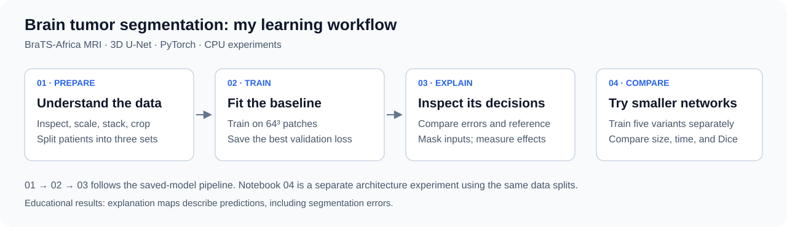
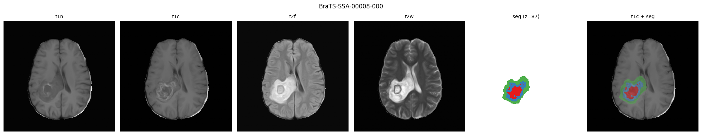
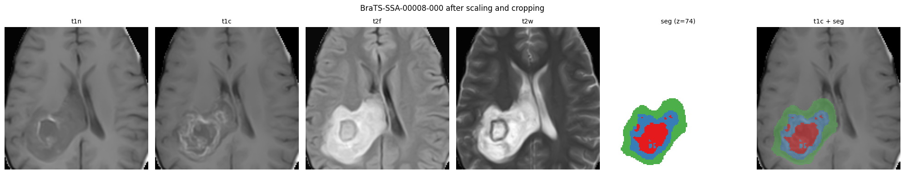
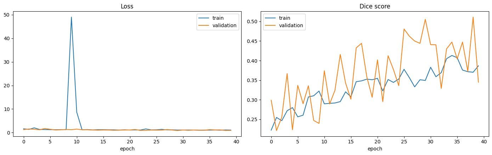
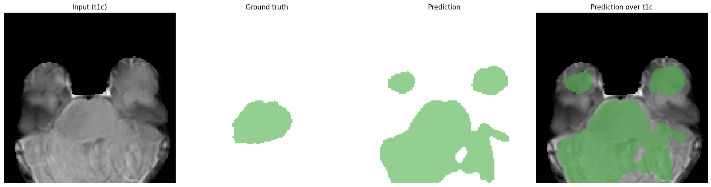
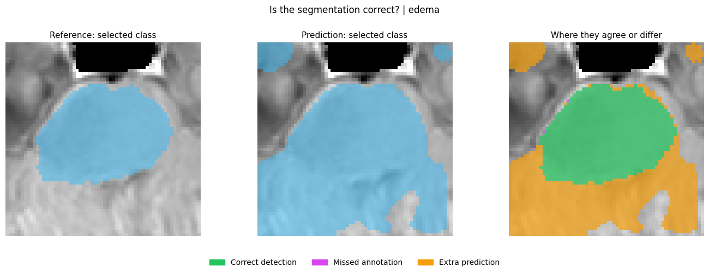
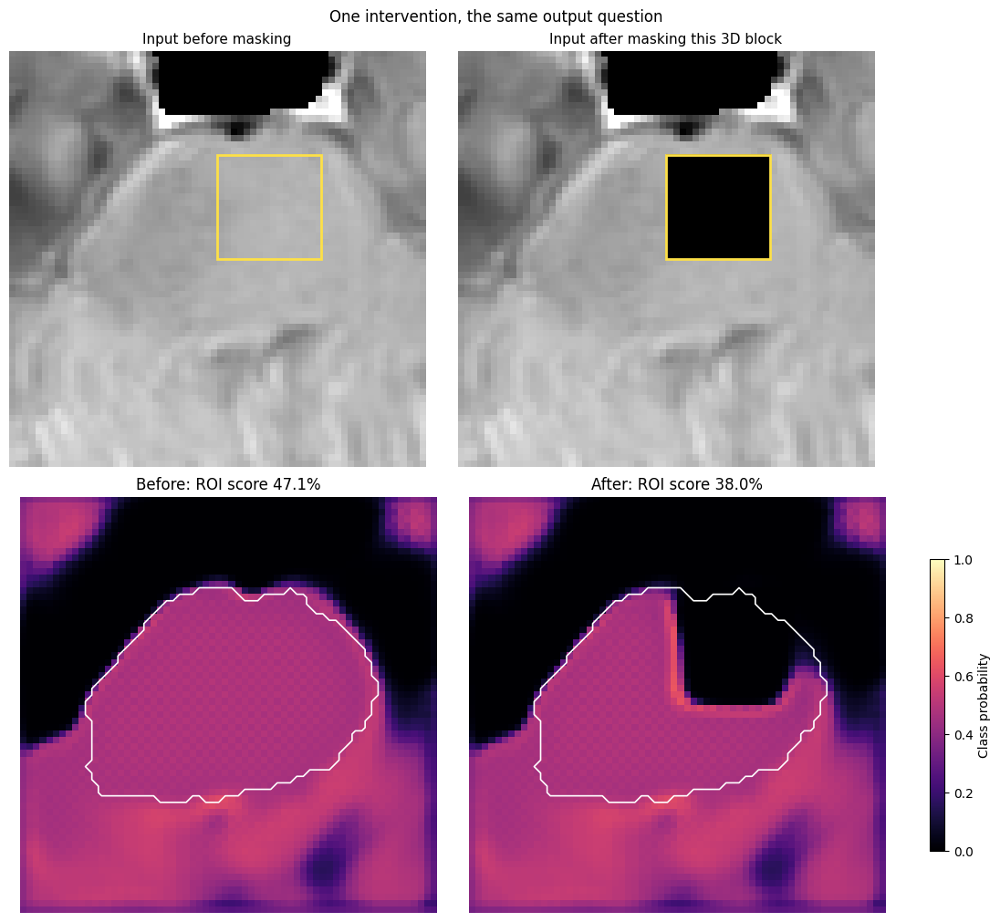
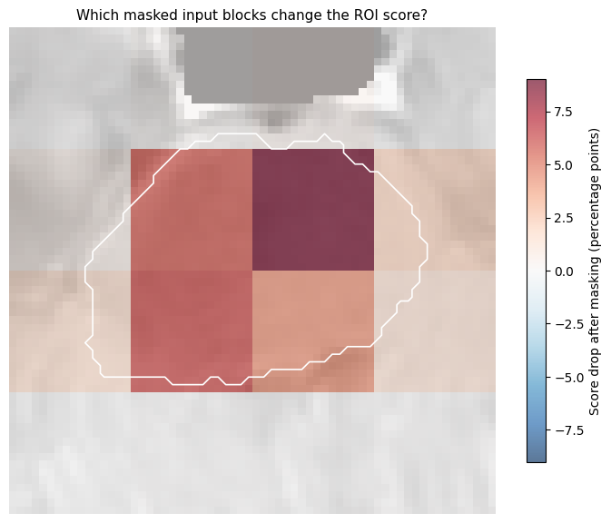
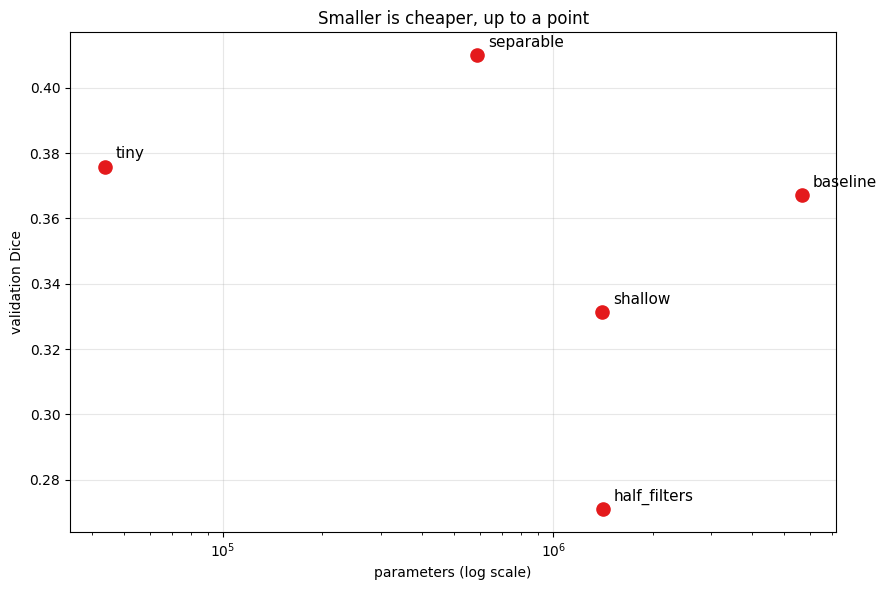

# Brain Tumor Segmentation with a Lightweight 3D U-Net

My exploration of BraTS-Africa MRI segmentation in **PyTorch**, from preparing the volumes to examining a saved model and comparing smaller architectures. I started from a tutorial discovered at Indaba, rewrote the explanations in my own words, and added a guided XAI analysis.

The experiments run on CPU, with GPU support when available. The saved results are learning experiments with substantial segmentation errors, rather than a clinically validated system.



## Follow the notebooks

| Notebook | What I explore |
|---|---|
| [01 · Data preparation](notebooks/01_brats_africa_preparation.ipynb) | Inspect MRI geometry and labels, normalize intensities, stack channels, crop, and split patients. |
| [02 · PyTorch training](notebooks/02_unet3d_pytorch_brain_segmentation.ipynb) | Train a 3D U-Net on random patches and save its best validation-loss checkpoint. |
| [03 · Explain the model](notebooks/03_explain_unet_pytorch.ipynb) | Separate correct and incorrect regions, then explore occlusion, modality removal, and gradient sensitivity. |
| [04 · Smaller architectures](notebooks/04_lightweight_architecture_personal.ipynb) | Train five configurations and compare parameter count, training time, and validation Dice. |

## The data and preprocessing

The data comes from [BraTS-Africa](https://www.cancerimagingarchive.net/collection/brats-africa/), described by [Adewole et al.](https://doi.org/10.1148/ryai.240528). The source tutorial also links to a [Kaggle copy](https://www.kaggle.com/datasets/aondonamoses/brats-africa). Obtain the data through its providers and follow their access and reuse terms.

Each patient has four MRI sequences: native T1 (`t1n`), contrast-enhanced T1 (`t1c`), FLAIR (`t2f`), and T2 (`t2w`), plus a segmentation mask. The tumor labels are **1: necrotic core**, **2: peritumoral edema**, and **3: enhancing tumor**. Label 0 is outside the annotated tumor regions.



*A saved example from notebook 01. The annotation colors are red for necrotic core, green for edema, and blue for enhancing tumor.*

In the recorded preprocessing run, I inspected **95 cases** and retained **89** after filtering crops with less than 1% annotated tumor. The resulting split contains **66 training, 13 validation, and 10 test cases**. These counts describe the local subset, not the complete BraTS-Africa collection.

The pipeline scales intensities **slice by slice**, stacks four channels, and crops `240 × 240 × 155` volumes to `128 × 128 × 128`. Images are stored as `float32`; masks are saved as four-channel one-hot `uint8` arrays.



*The fixed crop reduces memory use but can remove useful tissue. Visual checks remain necessary.*

## Training the baseline

The baseline has **5,646,260 parameters**. I train on `64 × 64 × 64` patches with batch size 2, NAdam, and a combined Dice and cross-entropy loss. The run allows up to 100 epochs and stopped at epoch 40. The saved checkpoint is selected by validation loss.



*The recorded run includes loss spikes and variable validation scores. It should not be read as smooth or fully stable convergence.*

| Saved evaluation | Mean Dice |
|---|---:|
| Validation patches | 0.4240 |
| Test patches | 0.3458 |

These scores average four classes, **including background**, over sampled random-patch batches. They are not full-volume tumor-only scores, and resampling can change them.



*Notebook 02 performs whole-volume inference for this visualization. Its displayed slice is separate from the random-patch evaluation above.*

## Understand an error before interpreting XAI

Notebook 03 uses a `64³` crop of `image_11.npy`. The default explanation measures the **mean edema probability inside the annotated edema region**, keeping that region fixed for every experiment.



*Green: correct edema detection. Magenta: missed edema. Orange: extra edema prediction. The images show one slice; the measurements below cover the entire crop.*

The crop-level edema Dice is **0.421**, with precision **0.268** and recall **0.984**. The model detects most annotated edema but predicts a much larger region: **79,249 extra voxels** versus **473 missed voxels**. It predicts neither necrotic core nor enhancing tumor in this crop, although both are annotated.

### A concrete occlusion experiment

I hide one `16³` input block in all four modalities and recompute the score in the same output region.



*For this deliberately selected block, the mean edema probability changes from **47.07% to 38.04%**, a drop of approximately **9.04 percentage points**, calculated before rounding. This is a change in the model score, not a change in Dice.*



*Red means masking lowers the score; blue means masking raises it. Squares correspond to the tested blocks. The white outline marks the fixed output region being scored, while the colored blocks describe input interventions.*

The notebook also removes entire modalities and explores gradient × input and SmoothGrad. Removing FLAIR or T2 nearly eliminates the selected score in this example. Such zero-replacement experiments can create unrealistic inputs; they do not establish biological causes or a general ranking of MRI usefulness. See the [full figure gallery](assets/README.md) for those maps and charts.

## Compare smaller U-Nets

Notebook 04 trains each variant from scratch for **five epochs**. It is a separate experiment; the XAI images above explain the baseline checkpoint from notebook 02.

| Configuration | Parameters | Training time | Validation Dice |
|---|---:|---:|---:|
| Baseline | 5,646,260 | 11.67 min | 0.3672 |
| Half filters | 1,412,444 | 7.43 min | 0.2709 |
| Separable | 586,980 | 20.86 min | 0.4100 |
| Shallow | 1,401,908 | 11.32 min | 0.3312 |
| Tiny | 43,884 | 9.63 min | 0.3758 |



The separable model has the highest measured Dice but takes the longest to train. The tiny model uses about **99.2% fewer parameters** than the baseline and reaches a slightly higher Dice in this short run. Fewer parameters therefore do not automatically imply faster training. These single-run scores do not establish a reliable architecture ranking.

## Run locally

From this project directory, create an environment and install the PyTorch workflow dependencies:

```bash
python -m venv .venv
```

Activate it in Windows PowerShell:

```powershell
.\.venv\Scripts\Activate.ps1
```

Or on Linux/macOS:

```bash
source .venv/bin/activate
```

Then install and launch:

```bash
python -m pip install numpy pandas matplotlib scipy nibabel scikit-learn split-folders gdown torch jupyterlab
cd notebooks
python -m jupyter lab
```

Select that environment as the notebook kernel and run the notebooks in order. Configure the raw data path in notebook 01. Its final preprocessing cell contains a Google Drive copy step; adapt or omit that step when working locally. On Colab, mount Drive before using Drive paths. Notebook 04 expects `DATA_ROOT` to locate `glioma_split_data` relative to its working directory.

After preprocessing and training, the relevant layout is:

```text
notebooks/
├── glioma_split_data/
│   ├── train/{images,masks}/
│   ├── val/{images,masks}/
│   └── test/{images,masks}/
└── saved_model/
    └── 3d_unet_pytorch.pt
```

The generated arrays and checkpoint are local run artifacts. The README figures can be viewed without downloading those artifacts or rerunning training.

## Limits and next steps

The current results include substantial errors. A stronger experiment would use fixed validation patches, complete seed control, repeated runs, per-class Dice, and held-out full-volume evaluation. The recorded geometry inspection also found **93 RAS and 2 LPS cases**; the current preprocessing does not reorient them, so orientation should be harmonized before a stronger comparison.

Training time is hardware-dependent. Inference latency and peak memory were not measured. Architecture-sweep scores, sampled test-patch scores, and single-crop XAI metrics answer different questions and should not be compared as equivalent benchmarks.

## Assets and provenance

The [assets gallery](assets/README.md) contains **18 figures exported from saved notebook outputs**, plus a workflow SVG. [manifest.json](assets/manifest.json) records each PNG's source notebook, cell, execution count, and checksum. No notebook was rerun to produce this documentation.

To refresh the exports after saving new notebook outputs, run from the project root:

```bash
python scripts/export_readme_assets.py
```

The export script updates the images and gallery, not the result tables in this README. Update those tables and captions if the experiment changes.

## Acknowledgments and references

This project builds on the tutorial by the **Medical Artificial Intelligence Laboratory, Lagos, with SPARK Academy**, discovered at Indaba. The data preparation, baseline training, and configurable architecture code originate from that tutorial; my presentation includes rewritten explanations and a guided XAI extension.

- [Original tutorial repository](https://github.com/SPARK-Academy-2025/lightweight-brats-tutorial).
- [Oladele et al., tutorial protocol](https://dx.doi.org/10.17504/protocols.io.dm6gpdwmdgzp).
- [Adewole et al., BraTS-Africa dataset publication](https://doi.org/10.1148/ryai.240528).
- [Ronneberger et al., U-Net](https://arxiv.org/abs/1505.04597) and [Cicek et al., 3D U-Net](https://arxiv.org/abs/1606.06650).
- [Zeiler and Fergus, occlusion analysis](https://arxiv.org/abs/1311.2901) and [Smilkov et al., SmoothGrad](https://arxiv.org/abs/1706.03825).

The source tutorial also credits Sreenivas Bhattiprolu's BraTS segmentation work for the original implementation lineage. Its [MIT license and copyright notice](notebooks/LICENSE) are retained. Dataset access and reuse terms are separate from the code license.
