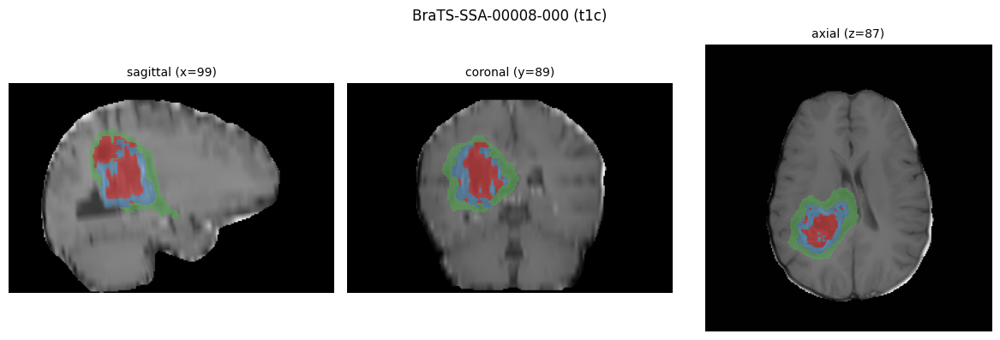
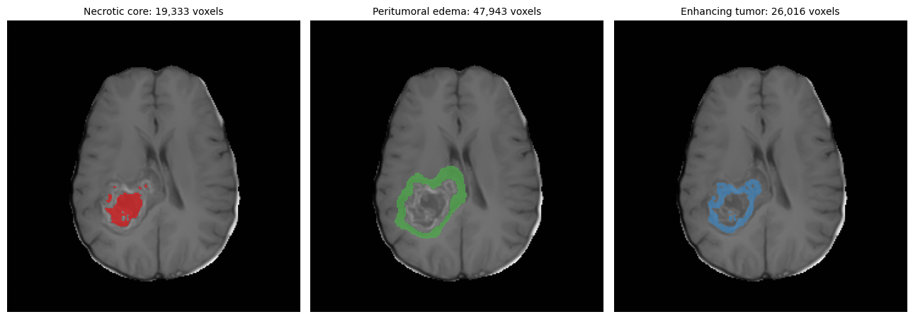
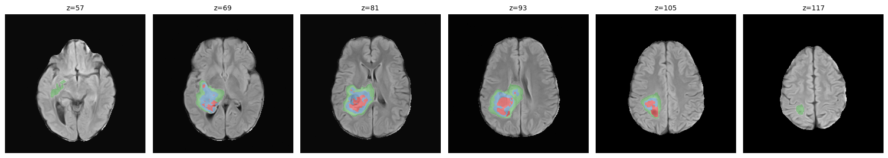
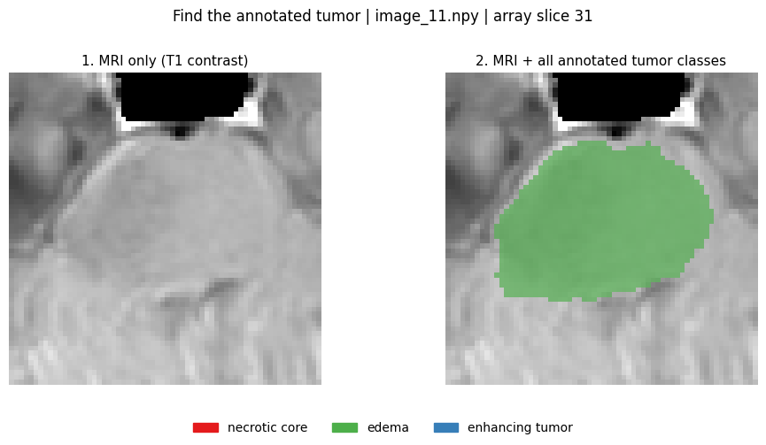
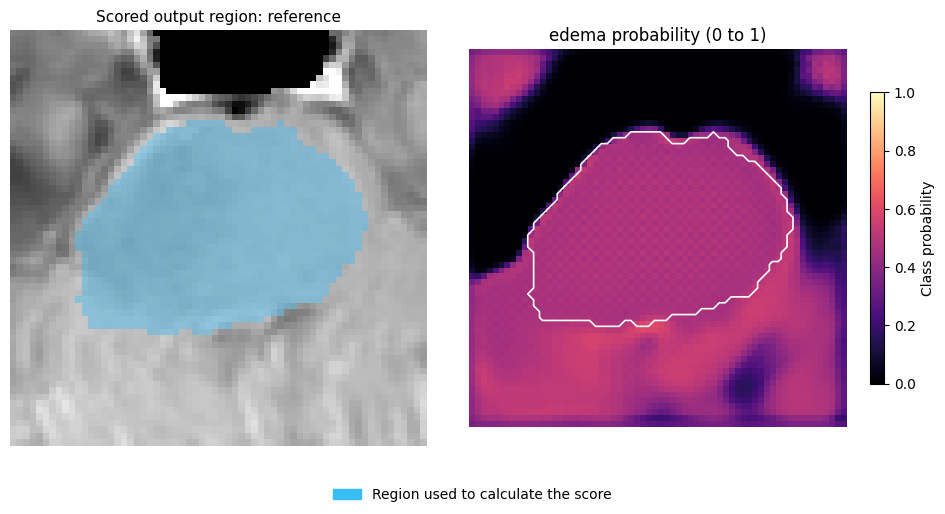
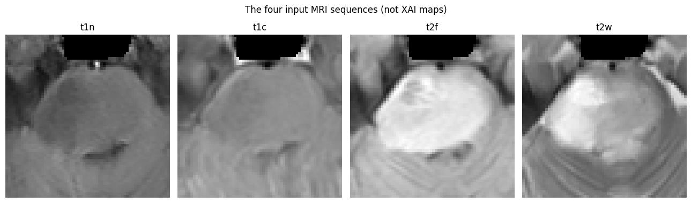
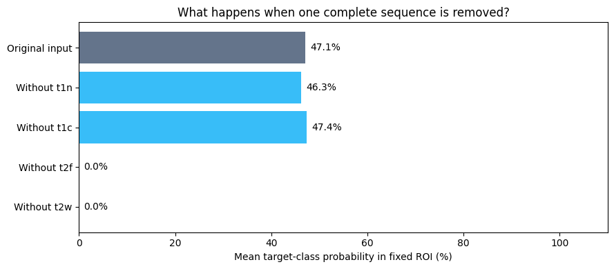
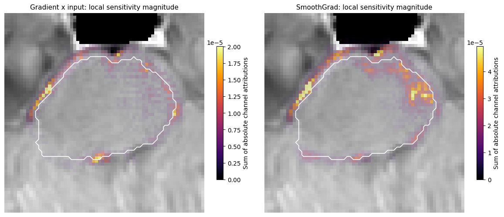
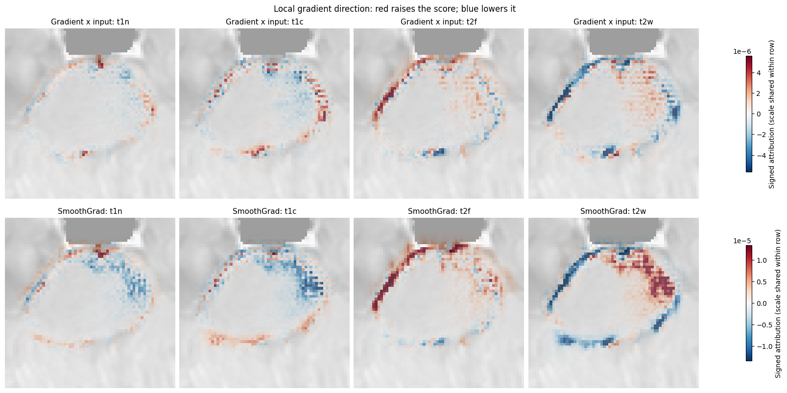
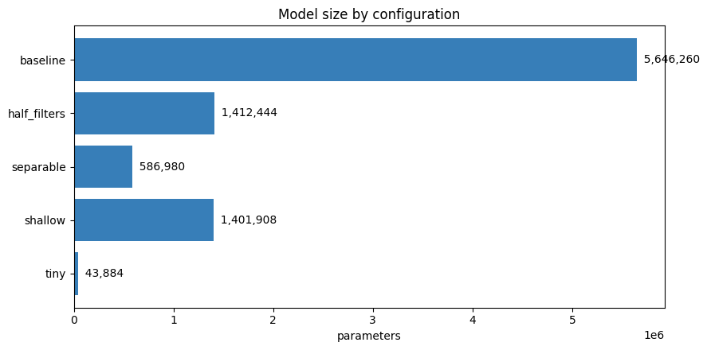

# Figure gallery and provenance

These 18 PNG figures are exported directly from saved notebook outputs. They are local experiment results, not generated illustrations. The pipeline SVG is a schematic of the workflow.

MRI examples use BraTS-Africa annotations. See the [project README](../README.md) for dataset and tutorial credits, result interpretation, and limitations.

Regenerate PNG files and their [provenance manifest](manifest.json) from the project root:

```bash
python scripts/export_readme_assets.py
```

The script uses Python's standard library and does not execute the notebooks. Save notebook outputs before exporting. Cell indices in the manifest are zero-based; update the mapping if cells are inserted, removed, or reordered.

## Workflow


## Four MRI sequences, reference mask, and overlay


Source: [01_brats_africa_preparation.ipynb](../notebooks/01_brats_africa_preparation.ipynb), cell 38 (zero-based), image 0.

## Reference annotation in three anatomical planes



Source: [01_brats_africa_preparation.ipynb](../notebooks/01_brats_africa_preparation.ipynb), cell 41 (zero-based), image 0.

## Each annotated tumor class shown separately



Source: [01_brats_africa_preparation.ipynb](../notebooks/01_brats_africa_preparation.ipynb), cell 43 (zero-based), image 0.

## Several slices through the annotated lesion



Source: [01_brats_africa_preparation.ipynb](../notebooks/01_brats_africa_preparation.ipynb), cell 45 (zero-based), image 0.

## Example after intensity scaling and cropping


Source: [01_brats_africa_preparation.ipynb](../notebooks/01_brats_africa_preparation.ipynb), cell 66 (zero-based), image 0.

## Saved training and validation curves


Source: [02_unet3d_pytorch_brain_segmentation.ipynb](../notebooks/02_unet3d_pytorch_brain_segmentation.ipynb), cell 38 (zero-based), image 0.

## Whole-volume inference displayed on a test slice


Source: [02_unet3d_pytorch_brain_segmentation.ipynb](../notebooks/02_unet3d_pytorch_brain_segmentation.ipynb), cell 45 (zero-based), image 0.

## MRI and reference tumor annotations



Source: [03_explain_unet_pytorch.ipynb](../notebooks/03_explain_unet_pytorch.ipynb), cell 9 (zero-based), image 0.

## Selected-class correct, missed, and extra regions


Source: [03_explain_unet_pytorch.ipynb](../notebooks/03_explain_unet_pytorch.ipynb), cell 11 (zero-based), image 0.

## Fixed output ROI and class probability



Source: [03_explain_unet_pytorch.ipynb](../notebooks/03_explain_unet_pytorch.ipynb), cell 13 (zero-based), image 0.

## One 3D input block masked: before and after


Source: [03_explain_unet_pytorch.ipynb](../notebooks/03_explain_unet_pytorch.ipynb), cell 17 (zero-based), image 0.

## Spatial occlusion effects in percentage points


Source: [03_explain_unet_pytorch.ipynb](../notebooks/03_explain_unet_pytorch.ipynb), cell 19 (zero-based), image 0.

## Four input modalities for the XAI example



Source: [03_explain_unet_pytorch.ipynb](../notebooks/03_explain_unet_pytorch.ipynb), cell 21 (zero-based), image 0.

## Fixed-region score after removing a whole modality



Source: [03_explain_unet_pytorch.ipynb](../notebooks/03_explain_unet_pytorch.ipynb), cell 21 (zero-based), image 1.

## Gradient x input and SmoothGrad magnitude



Source: [03_explain_unet_pytorch.ipynb](../notebooks/03_explain_unet_pytorch.ipynb), cell 25 (zero-based), image 0.

## Signed gradient explanations per MRI modality



Source: [03_explain_unet_pytorch.ipynb](../notebooks/03_explain_unet_pytorch.ipynb), cell 25 (zero-based), image 1.

## Parameter counts for five U-Net variants



Source: [04_lightweight_architecture_personal.ipynb](../notebooks/04_lightweight_architecture_personal.ipynb), cell 15 (zero-based), image 0.

## Parameter count versus short-run validation Dice


Source: [04_lightweight_architecture_personal.ipynb](../notebooks/04_lightweight_architecture_personal.ipynb), cell 28 (zero-based), image 0.
