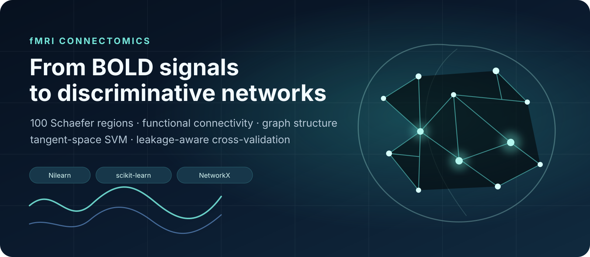

<p align="center">
  
</p>

# fMRI Connectomics and Machine Learning

This notebook follows a small fMRI study from the signal level to a predictive model. Rather than treating functional connectivity as an already prepared table, it starts from subject-level BOLD time series, builds connectomes, looks at their graph structure, and then asks whether those connectivity patterns can help distinguish **children from adults**.

The most useful part of the notebook is not just the classifier. It is the comparison between a convenient but leaky workflow and a stricter cross-validation pipeline. With tangent-space connectivity, the group reference itself is learned from the subjects provided to `ConnectivityMeasure`; if that reference is estimated before cross-validation, information from the held-out subjects can enter the representation. The notebook makes that issue explicit and keeps the full data-dependent preprocessing inside each training fold.

## What is special about fMRI here?

Functional MRI does not directly measure neuronal firing. It records the **BOLD (blood-oxygen-level-dependent) signal**, a hemodynamic response associated with changes in blood oxygenation and flow. The raw image is therefore four-dimensional: a 3D brain volume repeated over time.

Working voxel by voxel would leave us with a very high-dimensional signal. Here, the brain is first divided into **100 regions of interest (ROIs)** using the **Schaefer 2018 atlas, 7-network version**. For each subject, the notebook averages and cleans the BOLD signal inside each ROI, leaving a matrix of shape:

```text
number of time points × 100 brain regions
```

Those 100 regional trajectories are the starting point of the connectomics analysis.

## The analysis in the notebook

### 1. Parcellating the brain

The Schaefer atlas provides the common anatomical reference used across subjects. Its 100 cortical parcels become the nodes of every connectome built later in the notebook.

The example uses **50 subjects** from Nilearn's Development fMRI dataset and encodes the phenotype as:

```text
0 = Adult
1 = Child
```

### 2. Extracting regional BOLD time series

`NiftiLabelsMasker` extracts one representative signal per ROI for every subject. The supplied confounds are included during signal cleaning and each regional series is standardized.

This step changes the problem from analysing thousands of image voxels at every time point to analysing interactions between a fixed set of anatomically defined regions.

### 3. Building functional connectomes

Two views of connectivity are calculated:

- **Correlation** — how strongly two regional BOLD signals vary together.
- **Partial correlation** — the association between two regions after accounting for the other regional signals.

For one subject, both matrices are plotted side by side. A sparse connectome view then keeps only the strongest edges, making the dominant connections easier to see than in the full 100 × 100 matrix.

### 4. Looking at the connectome as a graph

A connectivity matrix can also be read as a network. The notebook thresholds the first subject's correlation matrix at `|r| > 0.4`, removes self-connections, and builds a binary NetworkX graph.

It then examines several properties that answer different questions about that network:

- **Average clustering coefficient** — how strongly neighbouring regions tend to connect with one another.
- **Degree** — which nodes behave as highly connected hubs.
- **Betweenness centrality** — which nodes often lie on shortest paths and may act as network bottlenecks.
- **Modularity** — how clearly the graph separates into communities.

The spring-layout graph is deliberately a network abstraction, not an anatomical brain map; the anatomical coordinates are used separately in the connectome visualisations.

### 5. Child-versus-adult classification

The predictive part uses **tangent-space functional connectivity**, univariate feature selection, and a **linear SVM** with five-fold stratified cross-validation.

This is where the notebook becomes particularly instructive. Two workflows are compared.

#### Global preprocessing

Tangent connectivity is estimated from all subjects, the 100 best features are selected using all labels, and only then is cross-validation performed. This is easy to write, but the held-out fold has already influenced both the tangent reference and feature selection.

#### Fold-wise pipeline

The stricter version puts the complete sequence inside a scikit-learn `Pipeline`:

```text
regional time series
        ↓
Tangent ConnectivityMeasure
        ↓
StandardScaler
        ↓
SelectKBest (100 features)
        ↓
Linear SVM
```

Cross-validation therefore begins from the subject-level time series. For each fold, tangent-space estimation, scaling, feature selection, and SVM fitting are learned only from the training subjects.

The notebook reports **AUROC** and **AUPRC** for both strategies together with an approximate fold-based 95% interval. The saved notebook intentionally contains no frozen execution outputs, so the numerical values are produced when the analysis is run on the local/runtime copy of the dataset rather than being hard-coded here.

## Interpreting the classifier

Because the classifier is linear, its coefficients can be traced back to the selected connectivity features. The notebook fits the strict pipeline on the full dataset only after cross-validation, restores the selected coefficients to the complete connectivity feature vector, and visualises the strongest 1% of model-weighted edges.

This last figure should be read as a **model interpretation**, not as a new estimate of predictive performance. A large SVM weight means that an edge contributes strongly to the fitted decision boundary after preprocessing; it does not by itself establish a causal developmental effect or a direct neurobiological mechanism.

## Why leakage matters especially with tangent connectivity

With ordinary tabular features, it is often obvious that feature selection must stay inside cross-validation. Tangent connectivity adds a less visible dependency: the tangent representation is defined relative to a covariance reference estimated from a group of subjects. Estimating that reference on the complete dataset before splitting therefore lets test subjects participate in the representation used for training.

That is why the strict pipeline receives the original list of regional time-series arrays rather than a connectivity matrix computed beforehand.

## Notebook map

| Stage | Main tools | Output |
|---|---|---|
| Atlas | Schaefer 2018, Nilearn | 100 cortical ROIs |
| Signal extraction | `NiftiLabelsMasker` | Regional BOLD time series |
| Connectivity | `ConnectivityMeasure` | Correlation and partial-correlation matrices |
| Network analysis | NetworkX | Clustering, hubs, betweenness, modularity |
| Predictive representation | Tangent connectivity | Vectorised connectome features |
| Feature selection | `SelectKBest(f_classif)` | 100 retained edges/features |
| Classification | Linear SVM | Child vs adult scores |
| Validation | Stratified 5-fold CV | AUROC and AUPRC |
| Interpretation | SVM coefficients + connectome plot | Strongest discriminative edges |

## Running the notebook

The notebook fetches the atlas and Development fMRI data through Nilearn, so the first execution needs internet access and enough local storage for the downloaded neuroimaging files.

The main dependencies are:

```bash
pip install nilearn numpy pandas matplotlib seaborn networkx scikit-learn
```

Then open and run:

```text
AIMS_09_fmri_connectomics.ipynb
```

The regional signal extraction is the slowest part of the workflow; Nilearn caching is enabled so repeated runs can reuse intermediate computations.

## A few interpretation boundaries

This notebook is a compact connectomics exercise, not a population-level developmental neuroimaging study. It uses only 50 subjects, one atlas resolution, one classification target, and a small set of modelling choices. The graph threshold (`|r| > 0.4`), number of selected features (`k=100`), and strongest-edge display thresholds are analysis choices rather than universal neurobiological cut-offs.

The point is therefore not to claim a definitive child–adult connectomic signature. The value of the notebook is in showing, in one reproducible workflow, how **BOLD time series become functional networks**, how those networks can be described mathematically, and how predictive modelling must be organised so that its validation remains honest.

---

### Files

```text
.
├── AIMS_09_fmri_connectomics.ipynb
├── README.md
└── assets/
    └── connectomics_banner.svg
```
