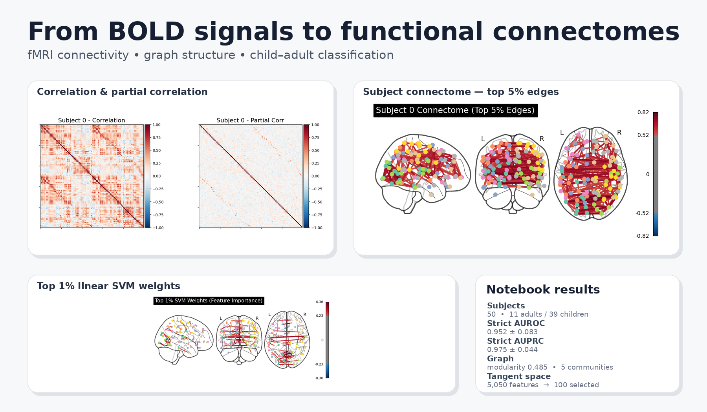
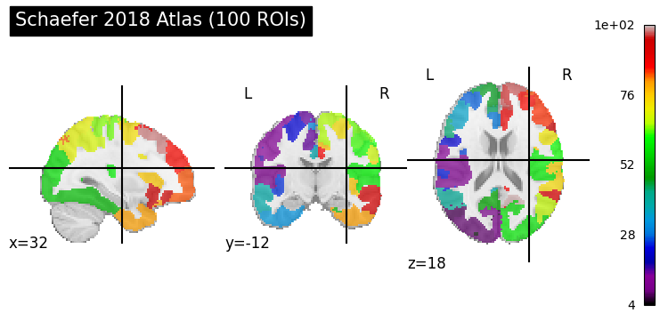
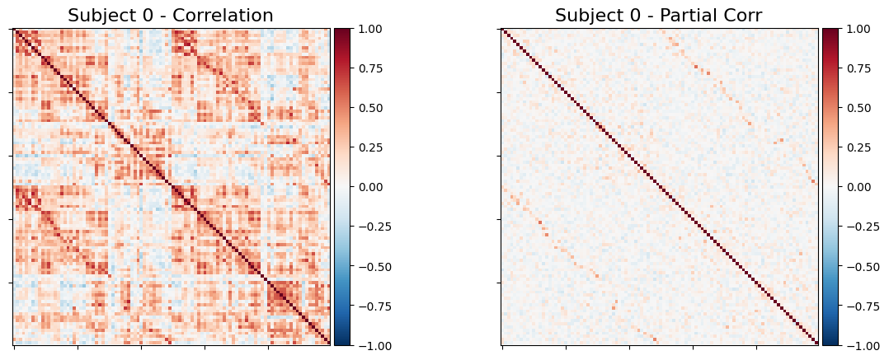
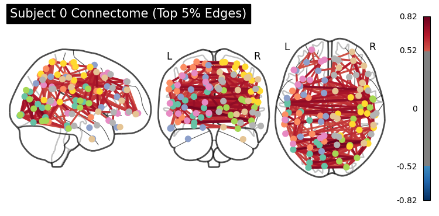
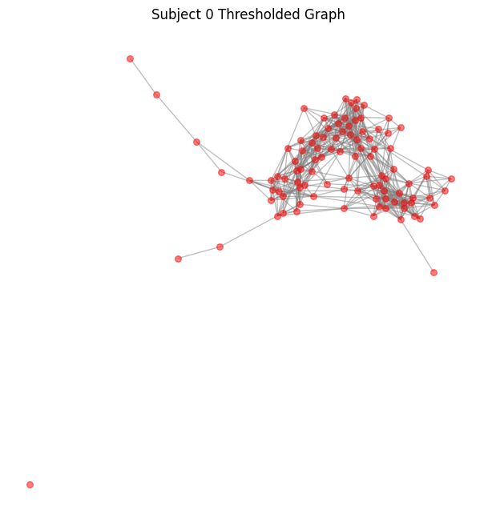
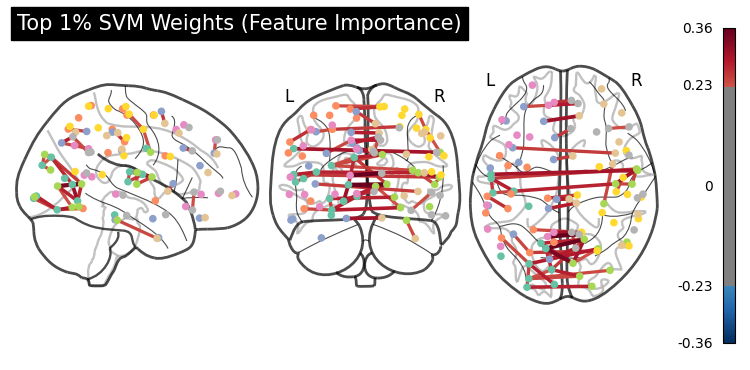

<p align="center">
  
</p>

# fMRI Connectomics: from regional BOLD signals to predictive networks

This notebook follows the full path from **fMRI time series** to a **functional connectome**, then asks a simple but useful question: can patterns of functional connectivity help distinguish **children from adults**?

What makes the notebook interesting is that it does not stop at one connectivity matrix. It moves through several representations of the same data: regional BOLD signals, correlation and partial-correlation matrices, thresholded graphs, tangent-space features, and finally a linear SVM whose strongest weighted connections can be mapped back onto the brain.

The figures below are the **actual outputs produced by the notebook**.

## What the fMRI signal represents

Functional MRI does not directly record neuronal firing. It measures the **BOLD (blood-oxygen-level-dependent) signal**, which reflects changes in blood oxygenation associated with neural activity. Each scan is therefore a sequence of 3D brain volumes collected over time.

Instead of modelling every voxel independently, this notebook uses the **Schaefer 2018 atlas with 100 cortical regions and 7 networks**. For each subject, the voxel-level fMRI data are reduced to one cleaned time series per region. The resulting subject representation is a matrix of:

```text
number of time points × 100 regions
```

Those regional trajectories are then compared pairwise to build a functional network.

## 1. Brain parcellation

<p align="center">
  
</p>

The atlas gives every subject the same set of **100 cortical nodes**. This common parcellation is essential because all later connectivity matrices must refer to the same regions in the same order.

The notebook uses **50 subjects** from Nilearn's development fMRI dataset:

- **11 adults**
- **39 children**

The classification target is encoded as `0 = Adult` and `1 = Child`.

## 2. From time series to connectivity matrices

After confound regression and regional signal extraction with `NiftiLabelsMasker`, the notebook computes two forms of connectivity.

<p align="center">
  
</p>

**Correlation** captures how strongly two regional BOLD signals fluctuate together. The matrix is relatively dense because many regions share common temporal variation.

**Partial correlation** asks a more conditional question: how strongly are two regions associated after accounting for the remaining regional signals? The resulting matrix is much sparser, which can be seen directly in the notebook output.

For 100 ROIs, each matrix is `100 × 100`. Rather than reading thousands of entries individually, the same matrix can be projected back onto brain coordinates.

## 3. Looking at the connectome anatomically

<p align="center">
  
</p>

The figure keeps only the **top 5% of edges** for visualization. This is not a new model; it is a way of seeing where the strongest functional relationships of one subject are located across sagittal, coronal, and axial views.

The colored nodes correspond to atlas regions, while the lines represent functional connections. Positive and negative connections are encoded by the connectome color scale.

## 4. Treating the connectome as a graph

The notebook also turns the first subject's correlation matrix into a binary graph by removing self-connections and retaining edges satisfying:

```text
|correlation| > 0.4
```

<p align="center">
  
</p>

This graph representation makes it possible to inspect network organization rather than only pairwise correlations. For this subject, the notebook reports:

| Graph quantity | Result |
|---|---:|
| Average clustering coefficient | **0.513** |
| Highest-degree nodes | **58 (26), 74 (24), 87 (23)** |
| Highest-betweenness nodes | **33, 73, 64** |
| Modularity | **0.485** |
| Detected communities | **5** |

The spring-layout drawing is only a graph visualization; node positions in that panel are not anatomical coordinates.

## 5. Classification in tangent space

For prediction, the notebook switches from ordinary correlation matrices to **tangent-space connectivity**. Tangent connectivity is useful because covariance-like matrices live on a curved geometric space; the tangent representation maps them into a vector space where standard machine-learning models can be applied more naturally.

With 100 ROIs and the diagonal retained by the current `ConnectivityMeasure(vectorize=True)` configuration, the fitted representation contains **5,050 features**. Univariate selection then keeps the **100 most informative features** before fitting a linear SVM.

The complete strict pipeline is:

```text
regional BOLD time series
        ↓
Tangent ConnectivityMeasure
        ↓
StandardScaler
        ↓
SelectKBest(f_classif, k=100)
        ↓
Linear SVM
```

## 6. Why the validation design matters

One of the most important parts of the notebook is the comparison between two ways of evaluating the classifier.

In the first version, tangent connectivity is fitted on **all subjects** and feature selection also sees **all labels** before cross-validation. This lets information from the future test folds influence the representation and selected features.

The strict version instead places the complete sequence inside a scikit-learn `Pipeline`. Each fold therefore learns the tangent reference, scaling, feature selection, and classifier using only its training subjects.

The difference is visible in the results:

| Evaluation | AUROC | AUPRC |
|---|---:|---:|
| Global preprocessing / leakage | **0.990 ± 0.017** | **0.996 ± 0.006** |
| Strict fold-wise pipeline | **0.952 ± 0.083** | **0.975 ± 0.044** |

The strict scores are still high, but the comparison shows why apparently small preprocessing decisions can make performance look more optimistic than it really is.

The intervals shown here are the notebook's approximate 95% intervals computed from the five cross-validation scores.

## 7. Which connections drive the linear classifier?

After validation, the strict pipeline is fitted to the complete dataset to inspect the coefficients of the linear SVM. The 100 selected coefficients are restored to the full tangent-connectivity feature space, and the strongest **1% of model weights** are displayed as a connectome.

<p align="center">
  
</p>

This is the notebook's most direct link between machine learning and connectomics: the classifier is no longer only a score, but a set of weighted connections distributed across the cortical network.

These edges should be interpreted as **features contributing strongly to the fitted decision boundary**, not as causal developmental connections. Their sign and magnitude describe the linear model after tangent transformation, scaling, and feature selection.

## The notebook at a glance

| Step | What happens | Main output |
|---|---|---|
| 1 | Fetch Schaefer 2018 atlas | 100 cortical ROIs |
| 2 | Load 50 development fMRI subjects | 11 adults, 39 children |
| 3 | Extract and clean regional BOLD signals | one time series per ROI |
| 4 | Estimate functional connectivity | correlation + partial correlation matrices |
| 5 | Visualize strongest subject-level connections | top-5% anatomical connectome |
| 6 | Threshold the matrix and build a graph | clustering, hubs, betweenness, modularity |
| 7 | Encode connectomes in tangent space | 5,050 connectivity features |
| 8 | Select features and train linear SVM | 100 selected features |
| 9 | Compare leaky and strict CV workflows | AUROC + AUPRC |
| 10 | Map fitted SVM weights back to the network | top-1% discriminative edges |

## Why this small notebook is useful

The dataset is deliberately small, so this is not intended as a definitive developmental-neuroscience study. Its value is in putting several ideas that are often taught separately into one reproducible workflow:

**fMRI → parcellation → BOLD time series → functional connectivity → graph analysis → tangent-space machine learning → leakage-aware validation → connectome interpretation.**

It also shows an important practical lesson: in connectomics, preprocessing is part of the model. A transformation such as tangent connectivity may look like a harmless feature-construction step, but because its group reference is estimated from data, it belongs inside cross-validation when performance is being evaluated.

## Running the notebook

The main Python packages are:

```bash
pip install nilearn numpy pandas matplotlib seaborn networkx scikit-learn
```

Then run:

```text
AIMS_09_fmri_connectomics.ipynb
```

Nilearn downloads the Schaefer atlas and development fMRI dataset on first use. Regional signal extraction is the slowest stage, so caching is useful when re-running the notebook.


# fMRI Connectomics: from regional BOLD signals to predictive networks and graph neural networks

This repository develops the same core idea at two different scales: **turn resting-state fMRI into a functional network, then ask what can be learned from the network without losing sight of how it was constructed**.

The first notebook is a compact developmental-connectomics study built around 50 subjects, the Schaefer atlas, graph analysis, tangent-space connectivity, and leakage-aware linear classification. The second notebook moves to **500 quality-checked ABIDE subjects**, uses the **116-region AAL atlas**, and compares a conventional SVM with a **Graph Attention Network (GAT)** for ASD-versus-control classification.

The two notebooks are complementary rather than interchangeable:

| Notebook | Cohort / task | Representation | Main model | Main lesson |
|---|---|---|---|---|
| `AIMS_09_fmri_connectomics.ipynb` | 50 development-fMRI subjects; child vs adult | Schaefer-100 connectivity, graph metrics, tangent space | Linear SVM | Data-dependent connectome preprocessing must stay inside validation |
| `fmri_gnns_abide.ipynb` | 500 ABIDE subjects; ASD vs control | AAL-116 partial-correlation connectomes | RBF-SVM + GAT | Explicit graph structure does not guarantee better prediction |

---

## Part I — Developmental fMRI connectomics

### From BOLD signals to a common cortical network

Functional MRI measures the **BOLD (blood-oxygen-level-dependent) signal**, not neuronal firing directly. The first notebook reduces each subject's fMRI sequence to regional time series using the **Schaefer 2018 atlas with 100 cortical regions and 7 networks**. Each subject is therefore represented as:

```text
number of time points × 100 regions
```

The notebook uses **50 subjects** from Nilearn's development fMRI dataset:

- 11 adults
- 39 children
- target encoding: `0 = Adult`, `1 = Child`

It then estimates both **correlation** and **partial correlation** connectivity matrices. A thresholded correlation graph (`|r| > 0.4`) is used for descriptive network analysis.

For the example graph shown in the original notebook, the reported graph statistics are:

| Quantity | Result |
|---|---:|
| Average clustering coefficient | **0.513** |
| Highest-degree nodes | **58 (26), 74 (24), 87 (23)** |
| Highest-betweenness nodes | **33, 73, 64** |
| Modularity | **0.485** |
| Detected communities | **5** |

The spring-layout graph is a network abstraction; its node positions are not anatomical coordinates.

### Tangent-space classification and leakage

For prediction, the notebook uses **tangent-space connectivity**. With 100 ROIs and the diagonal retained by the current vectorised configuration, the representation contains **5,050 features**. `SelectKBest(f_classif)` keeps 100 features before a linear SVM is fitted.

The strict pipeline is:

```text
regional BOLD time series
        ↓
Tangent ConnectivityMeasure
        ↓
StandardScaler
        ↓
SelectKBest(f_classif, k=100)
        ↓
Linear SVM
```

The notebook deliberately contrasts a globally preprocessed workflow with fold-wise preprocessing:

| Evaluation | AUROC | AUPRC |
|---|---:|---:|
| Global preprocessing / leakage | **0.990 ± 0.017** | **0.996 ± 0.006** |
| Strict fold-wise pipeline | **0.952 ± 0.083** | **0.975 ± 0.044** |

The point is methodological: the tangent reference and feature selection are learned from data. If they are estimated before cross-validation, held-out subjects can influence the representation. In the strict workflow, the complete transformation sequence is refitted inside each training fold.

The final linear-SVM weights can be mapped back to the connectome to show the strongest model-weighted edges. Those edges are **model features**, not causal developmental connections.

---

# Part II — ABIDE: SVM versus Graph Attention Network

## 1. Cohort and regional time series

The second notebook uses the **Autism Brain Imaging Data Exchange (ABIDE)** through Nilearn's preprocessed ABIDE PCP interface. It requests **500 quality-checked subjects** with AAL regional time series.

The downloaded cohort contains:

- **242 ASD participants**
- **258 controls**
- **410 males**
- **90 females**

The notebook encodes `0 = ASD` and `1 = Control`. The first subject has 196 time points across **116 AAL regions**.

<p align="center">
  
</p>

The split is stratified jointly by diagnosis and sex:

| Split | Subjects | ASD | Control | Male | Female |
|---|---:|---:|---:|---:|---:|
| Train | **374** | 181 | 193 | 307 | 67 |
| Validation | **76** | 37 | 39 | 62 | 14 |
| Test | **50** | 24 | 26 | 41 | 9 |

The test set is held out first, and the same subject indices are reused by the SVM and GAT experiments.

## 2. Partial-correlation connectomes

`ConnectivityMeasure(kind='partial correlation')` produces one **116 × 116** matrix per subject, giving an array of shape:

```text
(500, 116, 116)
```

Partial correlation is used here to describe the association between two regional signals after accounting for the remaining regions.

<p align="center">
  
</p>

A group-level descriptive comparison averages matrices separately for ASD and control participants and computes `Control − ASD`.

<p align="center">
  
</p>

The notebook reports:

- maximum absolute group-mean difference: **0.0359**
- mean absolute group-mean difference: **0.0040**

These maps are descriptive. They are not edge-wise significance tests and should not be interpreted as diagnostic biomarkers by themselves.

## 3. Classical baseline: vectorised connectome + RBF-SVM

Because each connectivity matrix is symmetric, the SVM uses only the upper triangular entries excluding the diagonal:

```text
116 × 115 / 2 = 6,670 unique connections
```

The resulting tabular matrix has shape **500 × 6,670**. A `StandardScaler` and RBF-kernel `SVC(C=1.0, probability=True)` are fitted on the training set.

### SVM results

| Split | Accuracy | Balanced accuracy | ROC-AUC |
|---|---:|---:|---:|
| Validation | **0.5263** | **0.5184** | **0.5925** |
| Test | **0.6400** | **0.6266** | **0.7420** |

The notebook also reports F1 = 0.6400 on validation and 0.7353 on test. Because label `1` is **Control**, scikit-learn's default binary F1 here is the **control-class F1**, not the ASD-class F1.

<p align="center">
  
</p>

The held-out ROC-AUC is clearly better than chance in this particular split, but the gap between validation and test performance is a reminder that a single split can be variable, especially in a heterogeneous multi-site dataset.

## 4. Turning each connectome into a graph

The GNN branch keeps network structure explicit. Each subject becomes a PyTorch Geometric `Data` object with:

- **116 nodes** — AAL brain regions;
- **edges** — retained partial-correlation connections;
- **edge attributes** — signed partial-correlation values;
- **graph label** — ASD or control;
- **7 node features** per region.

The seven node features are:

```text
3 anatomical coordinates (normalised MNI x, y, z)
+ 4 subject-specific connectivity descriptors
  - absolute node strength
  - thresholded degree
  - mean connectivity
  - connectivity standard deviation
```

The subject-specific features are z-scored within each subject. The coordinates are min-max normalised across atlas regions.

### Important implementation detail: graph threshold

The explanatory markdown in the notebook mentions `0.3`, but the executed graph construction actually sets:

```python
THRESHOLD = 0.05
```

The README follows the **executed code**. At this threshold the notebook creates 500 graphs and reports:

| Graph statistic | Value |
|---|---:|
| Mean retained directed edges | **4,533** |
| Minimum | **342** |
| Maximum | **6,324** |
| Mean density | **0.340** |

The example first graph contains 116 nodes, 7 features per node, and 5,166 retained directed edges.

## 5. Graph Attention Network

The graph classifier is a compact two-layer GAT:

```text
116-node subject graph
        ↓
GATConv(7 → 8, 4 attention heads)
        ↓
ELU + dropout
        ↓
GATConv(32 → 8, 1 head)
        ↓
global mean pooling
        ↓
Linear(8 → 2)
```

The model contains only **698 trainable parameters**. Edge weights are supplied to the attention layers as one-dimensional edge attributes. Training uses Adam (`lr=1e-3`, `weight_decay=1e-3`) and cross-entropy loss for 100 epochs; the checkpoint with the lowest validation loss is retained.

<p align="center">
  
</p>

The best validation loss is **0.6940**. The trajectories remain close to chance-level behaviour rather than showing successful separation of the classes.

## 6. Held-out GAT evaluation

The GAT does **not** outperform the classical baseline in this run.

| Metric | GAT test result |
|---|---:|
| Accuracy | **0.5200** |
| Balanced accuracy | **0.5000** |
| ROC-AUC | **0.4696** |
| Reported binary F1 | **0.6842** |

The apparently moderate F1 is misleading if read as ASD performance: because `1 = Control`, it is the **control-class F1**. The classification report shows that the GAT predicts every held-out subject as Control:

- ASD recall: **0.00**
- Control recall: **1.00**
- ASD F1: **0.00**
- Control F1: **0.68**

<p align="center">
  
</p>

This is a useful negative result. Representing a connectome as a graph and adding attention does not automatically create a stronger classifier. The model, graph construction, threshold, node features, training objective, cohort heterogeneity, and validation design all matter.

## 7. SVM vs GAT on the same test subjects

| Model | Accuracy | Balanced accuracy | ROC-AUC | Behaviour |
|---|---:|---:|---:|---|
| RBF-SVM | **0.6400** | **0.6266** | **0.7420** | Separates the classes to a useful degree on this split |
| GAT | **0.5200** | **0.5000** | **0.4696** | Collapses to the Control class |

The comparison is fair in one important sense: both models use exactly the same train, validation, and test subject indices. It is **not** a definitive architecture benchmark, because there is no repeated cross-validation, hyperparameter search, site-aware split, or uncertainty estimate around the test metrics.

## Methodological boundaries

These notebooks are learning and research-prototyping workflows, not clinical diagnostic systems. Several limitations should remain visible when interpreting the ABIDE experiment:

- ABIDE is **multi-site**, but the split is stratified only by diagnosis and sex; acquisition site is not explicitly controlled in the partitioning.
- The reported ABIDE results come from **one train/validation/test split**.
- The graph threshold (`0.05`) is an analysis choice rather than a biologically established cut-off.
- The GAT uses a small manually defined set of node descriptors and a very compact architecture.
- Group-average connectivity differences are descriptive and are not corrected inferential tests.
- Model attention weights, if inspected later, would be model-internal quantities rather than causal neurobiological explanations.

These constraints do not make the notebook uninformative. They make the main conclusion more precise: **connectome construction and evaluation design matter at least as much as model complexity**.

## Two workflows at a glance

```text
Notebook 1 — Developmental connectomics
fMRI volumes
   ↓
Schaefer-100 regional BOLD signals
   ↓
correlation / partial correlation
   ↓
graph analysis + tangent connectivity
   ↓
feature selection + linear SVM
   ↓
leakage-aware cross-validation + model-weighted edges

Notebook 2 — ABIDE ASD classification
preprocessed AAL regional time series
   ↓
116 × 116 partial-correlation matrices
   ├───────────────┐
   ↓               ↓
6,670 edges       thresholded subject graph
   ↓               ↓
RBF-SVM           7 node features + weighted edges
                   ↓
                  GAT
   └───────────────┘
          ↓
   common held-out test set
```

## Running the notebooks

Main dependencies across both workflows:

```bash
pip install nilearn numpy pandas matplotlib seaborn networkx scikit-learn torch torch_geometric
```

Run the notebooks independently:

```text
AIMS_09_fmri_connectomics.ipynb
fmri_gnns_abide.ipynb
```

The ABIDE notebook downloads regional derivatives on first execution. Its GAT stage is written to use CUDA when available, although the network itself is small.
```

---


All scientific figures shown in this README come directly from the notebook outputs rather than from generic stock or generated neuroscience illustrations.
